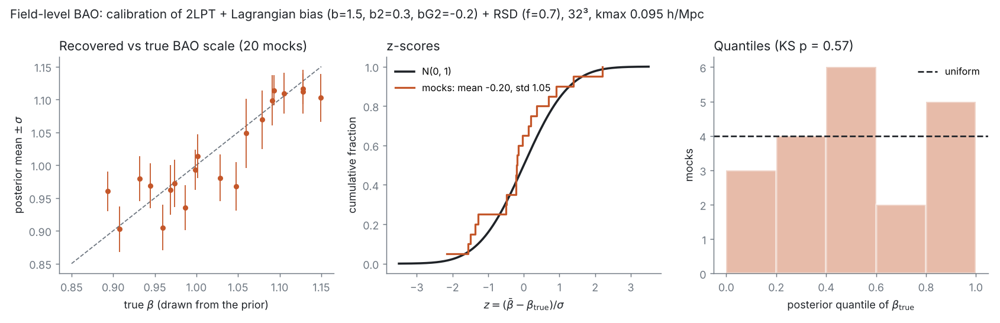

# Field-level BAO inference (prototype)

`FieldLevelBAO.h` is a small, self-contained prototype of field-level inference of the BAO scale in the spirit of
[arXiv:2407.01524](https://arxiv.org/abs/2407.01524): instead of compressing the data into a power spectrum, the
posterior of the initial density field and the BAO scale is sampled jointly, mode by mode, with Hamiltonian Monte
Carlo (HMC). It is a prototype: serial (OpenMP in the particle loops), a toy wiggle template, bias and growth-rate
parameters held fixed at their true values, and Gaussian noise of constant power. It is meant to show what the full problem needs (forward model, adjoint gradient,
sampler) and to be checked exactly where an exact answer exists.

## Model

- Parameters: the white-noise initial field s (one unit Gaussian per cell of an `nmesh`^3 grid) and
  beta = r_BAO / r_fid with a uniform prior on [`beta_min`, `beta_max`].
- Linear field: delta_k = T(k, beta) s_k with T = sqrt(P(k, beta) N^3 / V) for 0 < |k| < `kmax` and 0 above.
  P(k, beta) = P_smooth(k) [1 + A sin(k beta r_fid + phase) exp(-k / k_damp)] (`BAOSpectrum`); the default
  P_smooth is the Eisenstein & Hu no-wiggle spectrum normalised at k = 0.1 h/Mpc.
- Forward models (`Settings::model`):
  - `Linear`: pred_k = b delta_k.
  - `LPT1`: Zel'dovich displacement Psi_k = i k / k^2 delta_k, one particle per cell moved to x = q + Psi and
    assigned to an `nmesh_density`^3 grid (default 2 `nmesh`), pred_k = b delta_k of the particles.
  - `LPT`: 1LPT or 2LPT (`lpt_order`) particles with Lagrangian bias weights, optionally in redshift space:
    - 2LPT (Crocce et al. 2006): Psi2 = -(3/7) grad phi2, nabla^2 phi2 = sum_{i>j} (phi_ii phi_jj - phi_ij^2) =
      (delta^2 - t_ij t_ij) / 2 with t_ij = d_i d_j nabla^-2 delta, computed with FFTs on the `nmesh` grid.
    - Each particle carries w = 1 + b1L delta + b2 (delta^2 - <delta^2>) + bG2 G2 at its Lagrangian position, with
      b1L = b - 1 and G2 = t_ij t_ij - delta^2 (`bias`, `b2`, `bG2`); pred_k = delta_k of the weighted particles.
    - Redshift space along z with growth rate f (`growth_rate`): x_z += f Psi1_z + 2 f Psi2_z.
    - On large scales pred -> (b + f mu^2) delta_lin (tested to 0.3%).
  - Mass assignment (`assignment`): `Smooth` (default) spreads each particle with a compact smooth kernel
    (`kernel_width` = 6 density cells) and deconvolves the kernel's Fourier transform, so the predicted modes are
    the Fourier transform of the particles, (1/N_p) sum_p exp(-i k.x_p), to 3e-5 (width 6) or 4e-7 (width 8), and
    the gradient is continuous. `CIC` is cheaper (8 instead of 343 nodes per particle) and keeps the CIC window in
    the model. Either way the products in 2LPT and the bias operators are computed on the `nmesh` grid without
    dealiasing, which is part of the model definition.
- Likelihood: Gaussian per mode below `kmax` with noise power P_eps:
  -ln L = 1/2 sum_{all k, 0<|k|<kmax} |d_k - pred_k|^2 / (P_eps / V), the sum over the full Hermitian set of modes
  (the exact likelihood of a real field; the half-complex layout weights modes by 1 or 2).
- FFT conventions are those of `FFTWGrid` (r2c divides by N^3), so <|delta_k|^2> = P / V.

## Gradients

The gradient of U = -ln posterior is computed with hand-written adjoints at about twice the cost of a forward model:

1. Gbar_k = -(d_k - pred_k) / sigma^2 on the modes.
2. Linear: Q = b Gbar / N^3. LPT models: delta-bar = c2r(Gbar conj(factor)) / Nd^3 on the density grid; per
   particle x-bar = w (Nd^3 / Np) sum_y delta-bar_y grad W(x - y) (the gradient of the assignment kernel) and the
   weight adjoint w-bar = (Nd^3 / Np) sum_y delta-bar_y W(x - y); then back through the redshift-space mapping,
   Psi2 = (3/7) D[S2] (adjoint: S2-bar = (3/7) sum_c D_c^T Psi2-bar_c), the weights and S2 to delta-bar, t_ij-bar and
   Psi1-bar, and Q = r2c(delta-bar) + sum_ij (k_i k_j / k^2) r2c(t_ij-bar) + sum_c (-i k_c / k^2) r2c(Psi1-bar_c).
3. grad_s = c2r(T Q) + s and dU/dbeta = N^3 sum_full Re(conj(Q) dT/dbeta s_k).

Every gradient is checked against central finite differences (tests, agreement to ~1e-9 relative).

## Sampler

`sample(model, x0, beta0, options)` samples (x, beta) jointly with the generic HMC of
[`MCMC/HMC.h`](../MCMC/README.md#hmc) (dual-averaging step size, jittered leapfrog, windowed mass adaptation):

- Mass: Fourier-diagonal for the field, M_k = 1 + b^2 P / P_eps (the exact Hessian of the linear model), applied
  with FFTs as the operator block of `HMCMass`, and a diagonal mass for beta, adapted during warmup. Beta reflects at
  the prior edges. A target acceptance of ~0.65 mixes better here than the default 0.8.
- Parametrisation: with s sampled directly, beta and s are strongly correlated where the data dominate (changing beta
  at fixed s changes the predicted field). The sampled field is therefore partially centred,
  s_k = (T(beta_ref) / T(beta))^c x_k with c = S / (S + N) = b^2 P / (b^2 P + P_eps) per mode (`Settings::centering`;
  0 = white, 1 = fully centred). The prior and the Jacobian are included exactly. In the linear test this lowers the
  autocorrelation time of beta from ~13 to ~3 iterations.

## Validation

`tests/test_field_level.cpp` (`make -C FieldLevel/tests run`, about 3 minutes):

- Adjoint gradients in x and beta against finite differences for all models and parametrisations, including 1LPT
  and 2LPT with b2, bG2 and redshift space (relative agreement ~1e-8).
- `LPT` at first order without bias equals `LPT1`; the 1LPT + 2LPT displacement of two orthogonal plane waves
  equals the analytic one to 1e-16, also in redshift space; the smooth assignment equals the direct Fourier sum over
  particles; in the linear regime the 2LPT + b2 + bG2 + RSD prediction equals (b + f mu^2) delta_lin to 0.3%.
- CIC: a small plane wave makes its second harmonic only at second order (particles start mid-cell, see below).
- Mock data: sum |d|^2 / C over 20 mocks equals the number of modes (C = (b^2 P + P_eps) / V).
- Linear model: two independent HMC runs check rank-normalized split-Rhat and bulk/tail ESS through `MCMC/Diagnostics.h`. These are regression checks on beta, not production convergence certification. For the linear model the marginal posterior of beta is known exactly,
  ln L(beta) = -1/2 sum_full (|d_k|^2 / C_k + ln C_k). HMC agrees with it in the mean and the width
  (24^3, kmax = 0.07: exact 1.0469 +- 0.0669, HMC 1.0521 +- 0.0664, ESS ~190).
- 1LPT: beta is recovered from mock data made with the same model.

The example (`example/`, `./fieldlevel [linear|1lpt] nmesh kmax n_samples beta_true out`) at larger kmax
(the 1LPT run takes about 25 minutes on 2 cores):

| Model | Grid | kmax [h/Mpc] | beta_true | Exact marginal | HMC |
| --- | --- | --- | --- | --- | --- |
| Linear | 32^3, L = 1000 Mpc/h | 0.095 | 1.02 | 1.0232 +- 0.0333 | 1.0221 +- 0.0330 (1000 samples, ESS ~430) |
| 1LPT (CIC, particles on nodes; before the fixes below) | 48^3 (CIC 96^3) | 0.14 | 1.02 | - | 1.049 +- 0.018 (300 samples, ESS ~40) |

### Simulation-based calibration

`example/calibration` (`./calibration [linear|1lpt] nmesh kmax n_mocks first_seed n_samples out`) tests the whole
chain (forward model, gradients, sampler) statistically (Talts et al. 2018): for each mock, beta_true is drawn from
the prior (uniform on [0.85, 1.15]), the initial field from its prior and the data from the forward model plus noise;
then the posterior is sampled (150 warmup + 400 samples). If everything is correct,
z = (posterior mean - beta_true) / posterior std is ~N(0, 1) and the posterior quantile of beta_true is uniform.
Results at 32^3, kmax = 0.095 h/Mpc, b = 1.5, P_eps = 1000 (Mpc/h)^3:

| Model | Mocks | mean z | std z | KS p (quantile uniform) | posterior sigma | autocorrelation time |
| --- | --- | --- | --- | --- | --- | --- |
| Linear (HMC) | 30 | -0.11 +- 0.19 | 1.04 | 0.76 | 0.033 | 5.4 |
| Linear (exact marginal) | 30 | -0.08 | 1.03 | 0.88 | 0.033 | - |
| 1LPT (HMC) | 24 | -0.07 +- 0.20 | 1.00 | 0.85 | 0.037 | 10.8 |

For the linear mocks, HMC and the exact posterior agree mock by mock: (HMC mean - exact mean) / sigma has mean -0.03
and rms 0.14 (the Monte Carlo error expected for ~70 effective samples), and the posterior widths agree to 1% on
average. The 1LPT sampler is therefore calibrated at this precision (a bias larger than ~0.4 sigma or a width error
above ~30% would have shown up), and the 1.6 sigma offset of the single larger run above is consistent with a
fluctuation. The linear and 1LPT mocks use the same seeds, so their beta_true and initial fields coincide; the two
rows are not independent of each other. 24 mocks took about 40 minutes on two cores.
These linear and 1LPT runs used the first 1LPT model (CIC with particles on the density-grid nodes, see below); as
the mocks were made with the same model, they test the sampler and gradients, not the physics of that model.

The full model, `./calibration 2lpt` (2LPT, Lagrangian bias b = 1.5, b2 = 0.3, bG2 = -0.2, redshift space with
f = 0.7, smooth assignment; the bias, f and P_eps are held at their true values), on 20 mocks at the same settings:
z has mean -0.20 +- 0.24 and std 1.05, and the posterior quantiles of beta_true are uniform (KS p = 0.57);
posterior sigma 0.035, autocorrelation time 6.8, acceptance 0.71, no divergences. The 20 mocks took about 2.5 hours
on two cores.

### Mass assignment: particles on grid nodes

The first 1LPT model started the particles exactly on density-grid nodes (Nd = 2N). There CIC responds to a
displacement through |Psi| (the mass leaves the node towards whichever side it moves), which is not differentiable
at Psi = 0: a plane wave of amplitude 1e-4 produced a second harmonic at 38% of the fundamental, i.e. at linear
order, and mode by mode the prediction differed from b W_CIC delta_lin by ~24% in the linear regime even though the
cross-correlation was right. Every particle also sat on a kink of the likelihood, which is the likely cause of the
fragile finite-difference test (FL-4 in [KNOWN_ISSUES](KNOWN_ISSUES.md)). CIC now starts the particles mid-cell (and
undoes the shift with a phase), which removes the linear harmonic; but CIC is then exactly linear in displacements
below half a cell and misses their mode coupling. Hence the `Smooth` default.

## What a production version needs

- Sampling the bias parameters (b, b2, bG2), the growth rate and the noise power with the field (HMC blocks of
  `MCMC/HMC.h`), and a realistic noise model; here they are fixed at their true values.
- Dealiasing (padding) of the quadratic operators in 2LPT and the bias weights, higher-order bias and LPT, or a
  short PM run, and a wide-angle line of sight; the structure here (forward model, Gbar, adjoint chain to Q)
  carries over directly.
- MPI slabs: the FFTs are already FFTWGrid; the assignment and its adjoint need the usual particle exchange.
- Longer runs over several dispersed chains, using the shared rank-normalized split-Rhat and bulk/tail ESS diagnostics on beta and relevant field summaries, plus divergence checks and repeated-mock coverage.

## Known issues and deferred follow-ups

See [the review checklist](KNOWN_ISSUES.md) for the remaining safety, gradient-test,
scientific-validation and workspace issues. These follow-ups are deferred at the
user's request. The frozen-chain diagnostics finding was resolved by Engineering #17.
