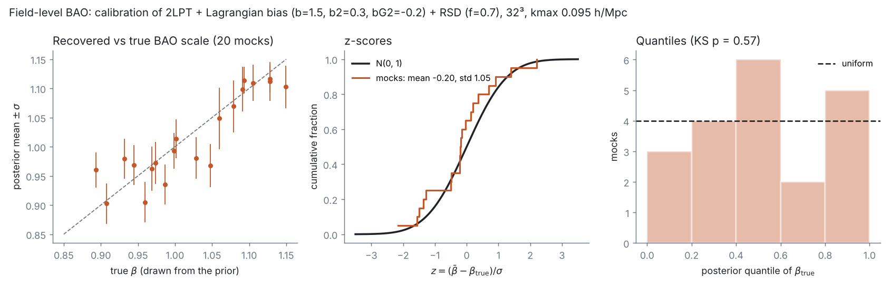

# Field-level inference

The [periodic framework](FRAMEWORK.md) now provides a general spectrum interface,
linear/Zel'dovich/2LPT forward models, distinct initial/bias/likelihood cutoffs,
joint field/bias/noise inference, MAP, exact linear references and streamed field
outputs. A separate [distributed linear backend](FRAMEWORK.md#distributed-linear-inference-stage-4a-12-november-2026)
provides MPI predictions, adjoints, exact conditionals, MAP and joint HMC; the
new [distributed 1LPT/2LPT backend](FRAMEWORK.md#distributed-2lpt-stage-4c-12-november-2026)
adds particle/mesh communication, the quadratic EdS source and matching bias/RSD
adjoints. [Distributed reconstruction outputs](FRAMEWORK.md#distributed-reconstruction-outputs-stage-4d-13-november-2026)
now include initial/matter density and Lagrangian displacement/velocity samples.
[Same-rank checkpoint/restart](FRAMEWORK.md#checkpointrestart-stage-4e-13-november-2026)
now preserves complete HMC/adaptation state. [Survey restart support](SURVEY.md#same-rank-survey-checkpointrestart)
adds full likelihood input identities. Current identity schema 3 fingerprints the
backend and complete grid partition; older schema-1/2 checkpoints require their
original code/build. The original BAO/LPT backend stays
single-rank. An initial [Cartesian survey layer](SURVEY.md) now supplies masked
Gaussian-field and positive-link Poisson-count likelihoods with MPI adjoints. A
[bounded nonlinear validation pass](validation/tests/SURVEY_RESULTS.md) is recorded; production
nonlinear/survey calibration remains open. See [the saved plan](FRAMEWORK_PLAN.md)
for the broader #52 scope.

The distributed linear/LPT framework, survey observations, same-layout restart,
distributed examples and survey validation driver now support **FFTWGrid slabs or
PencilGrid pencils**. See [backend selection](FRAMEWORK.md#frontend-backend-selection-step-4-14-november-2026)
and [frontend verification](validation/tests/FRONTEND_GRID_RESULTS.md). Library users select
the grid template explicitly; standalone distributed frontends use
`USE_PENCIL_GRID=true USE_MPI=true`. This does not change the serial BAO prototype.

A [periodic PM forward model](PARTICLE_MESH.md) now evolves whitened initial fields
with fixed flat matter/Lambda dynamics on slabs or pencils. This forward-only
milestone supplies final matter/particle fields. Its [discrete adjoint](PM_ADJOINT.md)
now supplies white/spectrum gradients with bounded checkpoint/recomputation.
The [periodic PM Gaussian posterior and MAP adapter](PM_POSTERIOR.md) connects it
to the shared likelihood, priors and optimizer. [Bounded HMC validation](validation/studies/pm_hmc_validation/README.md)
compares a two-mode conditional posterior with quadrature and checks short full-field
and joint-parameter runs. [Full-field PM validation](validation/studies/pm_full_validation/README.md)
now checks dispersed fixed/joint chains, exact-prior null directions and posterior
predictions for one small mock; broader calibration remains open.
[PM checkpoint/restart](PM_CHECKPOINT.md) now supports the same layout/build/thread
configuration, with explicit PM physics identity and complete HMC/adaptation state.
The [resolution study](validation/studies/pm_resolution_validation/RESULTS.md) adds 18-mode inference
and time/gradient checks, but finds unresolved spatial force/particle accuracy;
[dense particle sampling N>M](validation/studies/pm_oversampling_validation/RESULTS.md) now passes
bounded refinement checks with the same force law. Broader [PM-S1](KNOWN_ISSUES.md)
calibration remains open before a continuum-accuracy claim.
A [wider 122-mode study](validation/studies/pm_nonlinear_validation/RESULTS.md) now finds remaining
force-grid sensitivity at greater mode support/strength, while particle/time,
derivative and backend checks pass. It also tests fixed-parameter reconstruction
from finer-grid data; bounded MAP diagnostics are distinct from posterior coverage.
A [particle-sampled force reference](validation/studies/pm_force_reference_validation/RESULTS.md) now
shows that the observed density's force-grid sensitivity persists at N128, while
particle and time corrections are small. This forward-only check leaves the
posterior-gradient and optimizer issues open.
An [opt-in CIC-compensated force](validation/studies/pm_window_validation/RESULTS.md) now reduces the
controlled dense-grid density difference, with a verified adjoint and distinct
checkpoint identity. Raw joint-gradient accuracy remains unresolved; final CIC
observation windows and force windows are treated separately. The default is unchanged.

## BAO application (prototype)

`FieldLevelBAO.h` is a small, self-contained prototype of field-level inference of the BAO scale in the spirit of
[arXiv:2407.01524](https://arxiv.org/abs/2407.01524): instead of compressing the data into a power spectrum, the
posterior of the initial density field and the BAO scale is sampled jointly, mode by mode, with Hamiltonian Monte
Carlo (HMC). It is a prototype: serial (OpenMP in the particle loops), a toy wiggle template, bias and growth-rate
parameters held fixed at their true values, and Gaussian noise of constant power. It is meant to show what the full problem needs (forward model, adjoint gradient,
sampler) and to be checked exactly where an exact answer exists.

## Model

- Parameters: the white-noise initial field s (one unit Gaussian per cell of an `nmesh`^3 grid) and
  beta = r_BAO / r_fid with a uniform prior on [`beta_min`, `beta_max`].
- Linear field: delta_k = T(k, beta) s_k with T = sqrt(P(k, beta) N^3 / V) for 0 < |k| < `kmax` and 0 above.
  P(k, beta) = P_smooth(k) [1 + A sin(k beta r_fid + phase) exp(-k / k_damp)] (`BAOSpectrum`); the default
  P_smooth is the Eisenstein & Hu no-wiggle spectrum normalised at k = 0.1 h/Mpc.
- Forward models (`Settings::model`):
  - `Linear`: pred_k = b delta_k.
  - `LPT1`: Zel'dovich displacement Psi_k = i k / k^2 delta_k, one particle per cell moved to x = q + Psi and
    assigned to an `nmesh_density`^3 grid (default 2 `nmesh`), pred_k = b delta_k of the particles.
  - `LPT`: 1LPT or 2LPT (`lpt_order`) particles with Lagrangian bias weights, optionally in redshift space:
    - 2LPT (Crocce et al. 2006): Psi2 = -(3/7) grad phi2, nabla^2 phi2 = sum_{i>j} (phi_ii phi_jj - phi_ij^2) =
      (delta^2 - t_ij t_ij) / 2 with t_ij = d_i d_j nabla^-2 delta, computed with FFTs on the `nmesh` grid.
    - Each particle carries w = 1 + b1L delta + b2 (delta^2 - <delta^2>) + bG2 G2 at its Lagrangian position, with
      b1L = b - 1 and G2 = t_ij t_ij - delta^2 (`bias`, `b2`, `bG2`); pred_k = delta_k of the weighted particles.
    - Redshift space along z with growth rate f (`growth_rate`): x_z += f Psi1_z + 2 f Psi2_z.
    - On large scales pred -> (b + f mu^2) delta_lin (tested to 0.3%).
  - Mass assignment (`assignment`): `Smooth` (default) spreads each particle with a compact smooth kernel
    (`kernel_width` = 6 density cells) and deconvolves the kernel's Fourier transform, so the predicted modes are
    the Fourier transform of the particles, (1/N_p) sum_p exp(-i k.x_p), to 3e-5 (width 6) or 4e-7 (width 8), and
    the gradient is continuous. `CIC` is cheaper (8 instead of 343 nodes per particle) and keeps the CIC window in
    the model. Either way the products in 2LPT and the bias operators are computed on the `nmesh` grid without
    dealiasing, which is part of the model definition.
- Likelihood: Gaussian per mode below `kmax` with noise power P_eps:
  -ln L = 1/2 sum_{all k, 0<|k|<kmax} |d_k - pred_k|^2 / (P_eps / V), the sum over the full Hermitian set of modes
  (the exact likelihood of a real field; the half-complex layout weights modes by 1 or 2).
- FFT conventions are those of `FFTWGrid` (r2c divides by N^3), so <|delta_k|^2> = P / V.

## Gradients

The gradient of U = -ln posterior is computed with hand-written adjoints at about twice the cost of a forward model:

1. Gbar_k = -(d_k - pred_k) / sigma^2 on the modes.
2. Linear: Q = b Gbar / N^3. LPT models: delta-bar = c2r(Gbar conj(factor)) / Nd^3 on the density grid; per
   particle x-bar = w (Nd^3 / Np) sum_y delta-bar_y grad W(x - y) (the gradient of the assignment kernel) and the
   weight adjoint w-bar = (Nd^3 / Np) sum_y delta-bar_y W(x - y); then back through the redshift-space mapping,
   Psi2 = (3/7) D[S2] (adjoint: S2-bar = (3/7) sum_c D_c^T Psi2-bar_c), the weights and S2 to delta-bar, t_ij-bar and
   Psi1-bar, and Q = r2c(delta-bar) + sum_ij (k_i k_j / k^2) r2c(t_ij-bar) + sum_c (-i k_c / k^2) r2c(Psi1-bar_c).
3. grad_s = c2r(T Q) + s and dU/dbeta = N^3 sum_full Re(conj(Q) dT/dbeta s_k).

Every gradient is checked against central finite differences (tests, agreement to ~1e-9 relative).

## Sampler

`sample(model, x0, beta0, options)` samples (x, beta) jointly with the generic HMC of
[`MCMC/HMC.h`](../../MCMC/README.md#hmc) (dual-averaging step size, jittered leapfrog, windowed mass adaptation):

- Mass: Fourier-diagonal for the field, M_k = 1 + b^2 P / P_eps (the exact Hessian of the linear model), applied
  with FFTs as the operator block of `HMCMass`, and a diagonal mass for beta, adapted during warmup. Beta reflects at
  the prior edges. A target acceptance of ~0.65 mixes better here than the default 0.8.
- Parametrisation: with s sampled directly, beta and s are strongly correlated where the data dominate (changing beta
  at fixed s changes the predicted field). The sampled field is therefore partially centred,
  s_k = (T(beta_ref) / T(beta))^c x_k with c = S / (S + N) = b^2 P / (b^2 P + P_eps) per mode (`Settings::centering`;
  0 = white, 1 = fully centred). The prior and the Jacobian are included exactly. In the linear test this lowers the
  autocorrelation time of beta from ~13 to ~3 iterations.

## Validation

`tests/test_field_level.cpp` (`make -C FieldLevel/tests run`, about 3 minutes):

- Adjoint gradients in x and beta against finite differences for all models and parametrisations, including 1LPT
  and 2LPT with b2, bG2 and redshift space (relative agreement ~1e-8).
- `LPT` at first order without bias equals `LPT1`; the 1LPT + 2LPT displacement of two orthogonal plane waves
  equals the analytic one to 1e-16, also in redshift space; the smooth assignment equals the direct Fourier sum over
  particles; in the linear regime the 2LPT + b2 + bG2 + RSD prediction equals (b + f mu^2) delta_lin to 0.3%.
- CIC: a small plane wave makes its second harmonic only at second order (particles start mid-cell, see below).
- Mock data: sum |d|^2 / C over 20 mocks equals the number of modes (C = (b^2 P + P_eps) / V).
- Linear model: two independent HMC runs check rank-normalized split-Rhat and bulk/tail ESS through `MCMC/Diagnostics.h`. These are regression checks on beta, not production convergence certification. For the linear model the marginal posterior of beta is known exactly,
  ln L(beta) = -1/2 sum_full (|d_k|^2 / C_k + ln C_k). HMC agrees with it in the mean and the width
  (24^3, kmax = 0.07: exact 1.0469 +- 0.0669, HMC 1.0521 +- 0.0664, ESS ~190).
- 1LPT: beta is recovered from mock data made with the same model.

The example (`example/`, `./fieldlevel [linear|1lpt] nmesh kmax n_samples beta_true out`) at larger kmax
(the 1LPT run takes about 25 minutes on 2 cores):

| Model | Grid | kmax [h/Mpc] | beta_true | Exact marginal | HMC |
| --- | --- | --- | --- | --- | --- |
| Linear | 32^3, L = 1000 Mpc/h | 0.095 | 1.02 | 1.0232 +- 0.0333 | 1.0221 +- 0.0330 (1000 samples, ESS ~430) |
| 1LPT (CIC, particles on nodes; before the fixes below) | 48^3 (CIC 96^3) | 0.14 | 1.02 | - | 1.049 +- 0.018 (300 samples, ESS ~40) |

### Simulation-based calibration

`example/calibration` (`./calibration [linear|1lpt] nmesh kmax n_mocks first_seed n_samples out`) tests the whole
chain (forward model, gradients, sampler) statistically (Talts et al. 2018): for each mock, beta_true is drawn from
the prior (uniform on [0.85, 1.15]), the initial field from its prior and the data from the forward model plus noise;
then the posterior is sampled (150 warmup + 400 samples). If everything is correct,
z = (posterior mean - beta_true) / posterior std is ~N(0, 1) and the posterior quantile of beta_true is uniform.
Results at 32^3, kmax = 0.095 h/Mpc, b = 1.5, P_eps = 1000 (Mpc/h)^3:

| Model | Mocks | mean z | std z | KS p (quantile uniform) | posterior sigma | autocorrelation time |
| --- | --- | --- | --- | --- | --- | --- |
| Linear (HMC) | 30 | -0.11 +- 0.19 | 1.04 | 0.76 | 0.033 | 5.4 |
| Linear (exact marginal) | 30 | -0.08 | 1.03 | 0.88 | 0.033 | - |
| 1LPT (HMC) | 24 | -0.07 +- 0.20 | 1.00 | 0.85 | 0.037 | 10.8 |

For the linear mocks, HMC and the exact posterior agree mock by mock: (HMC mean - exact mean) / sigma has mean -0.03
and rms 0.14 (the Monte Carlo error expected for ~70 effective samples), and the posterior widths agree to 1% on
average. The 1LPT sampler is therefore calibrated at this precision (a bias larger than ~0.4 sigma or a width error
above ~30% would have shown up), and the 1.6 sigma offset of the single larger run above is consistent with a
fluctuation. The linear and 1LPT mocks use the same seeds, so their beta_true and initial fields coincide; the two
rows are not independent of each other. 24 mocks took about 40 minutes on two cores.
These linear and 1LPT runs used the first 1LPT model (CIC with particles on the density-grid nodes, see below); as
the mocks were made with the same model, they test the sampler and gradients, not the physics of that model.

The full model, `./calibration 2lpt` (2LPT, Lagrangian bias b = 1.5, b2 = 0.3, bG2 = -0.2, redshift space with
f = 0.7, smooth assignment; the bias, f and P_eps are held at their true values), on 20 mocks at the same settings:
z has mean -0.20 +- 0.24 and std 1.05, and the posterior quantiles of beta_true are uniform (KS p = 0.57);
posterior sigma 0.035, autocorrelation time 6.8, acceptance 0.71, no divergences. The 20 mocks took about 2.5 hours
on two cores.

### Mass assignment: particles on grid nodes

The first 1LPT model started the particles exactly on density-grid nodes (Nd = 2N). There CIC responds to a
displacement through |Psi| (the mass leaves the node towards whichever side it moves), which is not differentiable
at Psi = 0: a plane wave of amplitude 1e-4 produced a second harmonic at 38% of the fundamental, i.e. at linear
order, and mode by mode the prediction differed from b W_CIC delta_lin by ~24% in the linear regime even though the
cross-correlation was right. Every particle also sat on a kink of the likelihood, which is the likely cause of the
fragile finite-difference test (FL-4 in [KNOWN_ISSUES](KNOWN_ISSUES.md)). CIC now starts the particles mid-cell (and
undoes the shift with a phase), which removes the linear harmonic; but CIC is then exactly linear in displacements
below half a cell and misses their mode coupling. Hence the `Smooth` default.

## What a production version needs

- Sampling the bias parameters (b, b2, bG2), the growth rate and the noise power with the field (HMC blocks of
  `MCMC/HMC.h`), and a realistic noise model; here they are fixed at their true values.
- Dealiasing (padding) of the quadratic operators in 2LPT and the bias weights, higher-order bias and LPT, or a
  short PM run, and a wide-angle line of sight; the structure here (forward model, Gbar, adjoint chain to Q)
  carries over directly.
- MPI slabs: the FFTs are already FFTWGrid; the assignment and its adjoint need the usual particle exchange.
- Longer runs over several dispersed chains, using the shared rank-normalized split-Rhat and bulk/tail ESS diagnostics on beta and relevant field summaries, plus divergence checks and repeated-mock coverage.

## Known issues and deferred follow-ups

See [the review checklist](KNOWN_ISSUES.md) for status. FL-1/FL-2 MPI/input safety
are resolved: multi-rank construction rejects before FFT grid allocation, all public
field/filter dimensions are checked, and test/example startup uses FMLSetup once.
MPI-enabled builds are supported with one rank; distributed prediction/adjoints
remain future work. `make -C FieldLevel/tests USE_MPI=true safety` runs one-rank
input checks and deliberate rejection on 2/4 ranks; `run` also executes the existing
inference suite on one rank. Clean/rebuild when changing MPI/precision settings.
The gradient-portability, scientific-validation and workspace follow-ups remain
deferred. Engineering #17 resolved the frozen-chain diagnostics finding.

The saved [general-framework plan](FRAMEWORK_PLAN.md) separates prior/evolution,
tracers, observations, likelihood and inference. Stages 1–3 now have an initial periodic implementation documented in [FRAMEWORK.md](FRAMEWORK.md);
backlog #52 remains open until the broader scope is delivered.

## Scientific method references

- [Jasche & Wandelt (2013), BORG](https://arxiv.org/abs/1203.3639): Bayesian initial-condition reconstruction with dynamical evolution.
- [Stadler, Schmidt & Reinecke, LEFTfield](https://arxiv.org/abs/2409.10937): perturbative field-level forward modeling and numerical convergence.
- [Field-level BAO inference](https://arxiv.org/abs/2407.01524): joint inference of the initial field and BAO scale, motivating the prototype.

These are scientific reference directions, not code ports or compatibility claims.
The native periodic framework and its adjoints are tested against exact linear
results, finite differences and MPI decompositions. These checks do not establish
nonlinear accuracy against independent simulations or realistic survey validity.

## Fixed PM observation convention (15 November 2026)

The [fixed-response study](validation/studies/pm_observation_validation/RESULTS.md) now implements the
actual signal response, transpose and checkpoint identity. With a common M32 CIC
observation window, compensated M32→M64 density and joint-gradient corrections
are 0.0309% and 0.476%, passing the original bounded criteria. The uncompensated
joint-gradient baseline still fails at 41.6%. Custom real coefficients, noise after
response, both distributed backends and legacy bitwise compatibility are tested.
This is one finite-reference realization; adequate broader gradient sampling,
posterior calibration, MAP conditioning and PM survey/tracer/RSD work remain open.

## Refined-data compensated PM reconstruction (15 November 2026)

The [new reconstruction study](validation/studies/pm_reconstruction_validation/RESULTS.md) generates
a compensated N128/M64/32-step mock and fits at N32/M16/16 steps with a common
M16 observation window and fixed nuisance parameters. At 24 accepted iterations,
initial coefficient error is 0.2696 of the zero-field baseline,
correlation 0.9643, and residual 0.7881 noise SD. Optimizer
status is MaximumIterations; raw and projected gradients are retained with the plots.
Serial/MPI slab/pencil/sanitizer replay and legacy bitwise comparisons pass.
A costlier N64/M32 attempt is retained; the public optimizer is unchanged.
Broader seed/amplitude/refinement checks remain explicitly deferred by request;
this is reconstruction validation, not posterior calibration. Item 52 remains open.

## MAP optimizer and frozen-data comparison (15 November 2026)

`MAP.h` adds an options overload with limited-memory L-BFGS and value-only
gradient descent; legacy `map()` is unchanged. `BasicPosterior::value` omits the
forward-model adjoint while retaining the normalized target and priors. Distributed
field/scalar reductions, controls, curvature and history limits are tested.
[The frozen-data comparison](validation/studies/pm_optimizer_validation/RESULTS.md) preserves legacy24
coefficients bitwise; value-only GD cuts pullbacks from 144 to 25.
L-BFGS status is LineSearchFailed, raw gradient 0.000116038 at
83 iterations with tolerance2e-5. Its recovery/error and work/memory
measurements are reported separately. Broader refinement remains deferred, and
posterior calibration/PM survey/tracer/RSD work remains open.

See [MAP optimization](MAP.md) for the options API, value-only evaluations,
L-BFGS safeguards, distributed scalar reductions and memory accounting.

## Stalled PM reconstruction diagnosis (16 November 2026)

[Read-only stationarity probes](validation/studies/pm_stationarity_validation/RESULTS.md) reproduce
iteration83 and capture its full state. Fresh/reused caches and replay budgets
0/1/4/8 give identical gradients/values; three stencil-preserving directional
checks pass. A particle lies3.19e-10 force cells from a final CIC face. Larger
trials cross stencils, while smaller smooth-branch decreases around2e-12 are
masked by ordinary objective evaluation/subtraction errors around1e-11. The
public value/full base targets agree; no cache/adjoint discrepancy was observed
in these tests. Solver and assignment are unchanged. Next test stable objective
change comparisons for Armijo before another full reconstruction. Broader
refinement remains deferred; convergence and general calibration remain open.

## Stable Armijo comparisons (16 November 2026)

`BasicPosterior` gains an opt-in stable change API for likelihoods implementing
local differences; Gaussian variance/normalization and field/scalar priors are
included. Defaults and ordinary target evaluations remain unchanged.
[The frozen-state/full-fit check](validation/studies/pm_stable_armijo_validation/RESULTS.md) accepts
the diagnosed hidden descent. Stable L-BFGS uses 594 value trials versus
1311, but ends at iteration 98 with raw gradient 0.00013902
and status LineSearchFailed: convergence remains unresolved. Stable GD
retains its 24-step coefficients bitwise. MPI/sanitizer and default-compatibility
checks pass. Broader refinement/calibration remains deferred; next inspect CIC
regularity/forward precision at the new endpoint before changing assignment.

## Stable endpoint regularity diagnostic (16 November 2026)

[Iteration-98 probes](validation/studies/pm_stable_stationarity_validation/RESULTS.md) reproduce the
stable fit bitwise. A final-node CIC coordinate lies 7.47e-13 grid cells from a
face. One-sided negative-gradient slopes differ across two stencil axes: the
branch-preserving side agrees with the adjoint, while the nominal descent side
increases the target. All 40 reconstructed search trials have positive stable
changes; ordinary subtraction would accept 17 tiny apparent improvements.
Fresh/reused caches and checkpoint budgets agree exactly. Two central derivative
gates remain unresolved because no eligible same-stencil pairs exist; the report
retains passed=false and consistency_passed=true. Convergence remains open.
Next consider opt-in TSC with matched deposit/gather derivatives and adjoint,
preserving CIC defaults. No assignment or stopping-rule change was made. Broader
refinement/calibration remains deferred.

## Opt-in TSC PM assignment (16 November 2026)

[Matched-assignment reconstruction](validation/studies/pm_tsc_validation/RESULTS.md) converges in
16 iterations with raw gradient 5.6502e-06 at the unchanged
2e-5 tolerance. TSC covers force deposition/gather, reported density, matching
adjoint and optional force compensation. CIC defaults and checkpoint identities
remain compatible. Targeted serial/MPI/pencil/sanitizer and checkpoint checks pass.
The matched TSC reference changes the discrete target; this is one finite
realization, not general convergence or posterior calibration. Broader refinement
remains deferred. Stable objective comparisons remain opt-in.

## Joint TSC MAP validation (16 November 2026)

[Initial field, amplitude and noise](validation/studies/pm_tsc_joint_validation/RESULTS.md) converge
jointly in 54 iterations with joint norm 9.84911e-06
at tolerance 2e-5. Scalar gradient identities and six refined directional gates
pass; serial/slab/pencil/sanitizer checks agree and fixed mode reproduces the
committed TSC driver bitwise. No library or optimizer code changed. This study
explicitly widens amplitude support to [-4,4]; Gaussian mean/scale remain fixed.
The high joint-MAP amplitude follows the whitened-coordinate density mode and
must not be interpreted as an unbiased or marginalized amplitude estimate.
Physical initial-field correlation is 0.964540. General scalar
posterior inference, coverage and broader refinement remain deferred.

## Bounded TSC posterior pilot (16 November 2026)

[Active-field/amplitude/noise HMC](validation/studies/pm_tsc_posterior_validation/RESULTS.md) completes
four N16 particle chains on the frozen data, M16 force mesh and 16 time steps,
as selected by the user. Exact inactive-Gaussian marginalization and physical
coordinates include the 122*A/2 Jacobian; direct target/gradient checks pass.
All Rhat values are <1.05 and there are no retained divergences, but bulk/tail ESS
criteria remain failed (minima 93.3/180.9); the report
keeps passed=false. Scalar intervals and predictions are exploratory. N32 mixing
and coverage remain unvalidated. A <=16-mesh bounded dense lookup reduces a short
case's CPU time about 21% with bitwise-identical outputs; larger meshes stay sparse.
PM/LPT, MPI/pencil, sanitizer and old-checkpoint checks pass. Broader refinement
remains deferred; more effective draws are needed before calibrated inference.

## Longer N16 TSC posterior mixing validation (16 November 2026)

[The fixed-schedule 512-draw run](validation/studies/pm_tsc_posterior_validation/LONG_VALIDATION_RESULTS.md)
clears all original finite-chain gates for the declared N16 periodic PM target:
four chains, maximum 6 leapfrog steps, 64 warmup and 512 retained draws each.
Across all 248 active-field/squared-field/scalar/potential/norm features, maximum
Rhat is 1.0071, minimum bulk ESS 471.1 and minimum tail ESS 726.0, with zero
retained divergences. The 192-draw prefix and saved analysis reproduce exactly.
The earlier 128/192-draw reports retain their failed flags; longer sampling with
an increased declared budget resolves this bounded target's mixing gate.
N32 mixing, repeated-mock coverage and a scalable production full-grid metric
remain open. The dense metric and scalar-cache adapter remain validation code;
production sampler defaults are unchanged.

## Independent same-model N16 posterior validation (17 November 2026)

[The independent mock](validation/studies/pm_tsc_posterior_validation/INDEPENDENT_MOCK_RESULTS.md)
uses fresh IC191/noise192 with matching N16/M16/16-step generation and inference.
The frozen four-chain 64-warmup/512-retained protocol passes all original 248
feature gates: maximum Rhat 1.0064, minimum bulk/tail ESS 463.9/552.9 and zero
retained divergences. Both injected scalar parameters lie within their 95%
marginal intervals; initial-field mean correlation is 0.9775. Recovery is
descriptive on one mock, not repeated-mock coverage. A data-only MAP and fresh
fixed metric precede sampling; no post-result retuning. New generator/seed
plumbing passes serial, slab/pencil MPI 1/2/4-rank and sanitizer checks, with
legacy default outputs preserved. The full science chains run in serial.
The original refined-data reference remains separate. N32 mixing, physical
convergence, multiple-mock calibration and scalable full-grid metrics remain open.

## Repeated same-model N16 posterior validation (17 November 2026)

[Results and plots](validation/studies/pm_tsc_posterior_validation/REPEATED_MOCK_RESULTS.md).

The original same-model N16 plan declared IC/noise seeds 291/292, 391/392,
491/492 and 591/592, excluding the previous 191/192 case. The user requested
skipping the fourth after two results were known and the third was running.
Three datasets participate; the fourth is user-skipped, not missing or failed. The frozen
four-chain 64-warmup/512-retained schedule and all 248 strict feature gates stay
unchanged. Completed: 3/3; mixing passes: 3/3;
consistency passes: 3/3; campaign passed=True.
No failed case is replaced, extended or dropped. Each dataset has a data-only
MAP and a fresh metric frozen before sampling. The report separates individual
mixing verdicts from scalar interval inclusion and field recovery. Three datasets
give broad coverage uncertainty; correlated field-mode counts are not pooled.
This is limited repeated-data recovery at fixed true hyperparameters, not SBC.
Native sources/binaries remain unchanged; synthetic reporting and raw/aggregate
replay checks are recorded. N32 mixing, physical convergence, larger calibration
ensembles and scalable full-grid metrics remain open. This validation pilot
buffers chain output until completion and has no mid-chain restart checkpoint;
finished mocks are persistent, but interrupted unfinished chains must restart.
