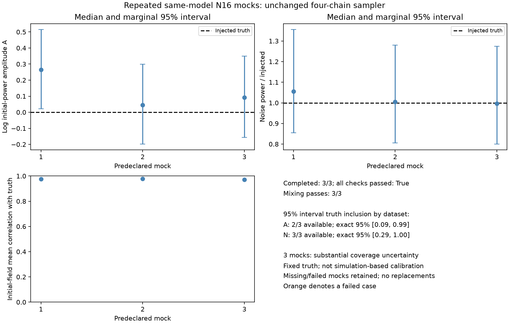

# Validation records

These are historical, bounded studies. Reports retain their original conclusions,
including failures. Large inputs/outputs and exploratory source are in the
[verified archive](ARCHIVE.md); compact outcome excerpts are in
[outcomes.json](validation/outcomes.json). Maintained driver entry points are
[listed separately](../validation/README.md).

## pm_force_reference_validation

[Recorded report](validation/studies/pm_force_reference_validation/RESULTS.md). Recorded overall flag: `passed=false`.

## pm_full_validation

[Recorded report](validation/studies/pm_full_validation/RESULTS.md). Recorded overall flag: `passed=true`.

## pm_hmc_validation

[Recorded report](validation/studies/pm_hmc_validation/RESULTS.md). Recorded overall flag: `passed=true`.

## pm_nonlinear_validation

[Recorded report](validation/studies/pm_nonlinear_validation/RESULTS.md). Recorded overall flag: `passed=false`.

## pm_observation_validation

[Recorded report](validation/studies/pm_observation_validation/RESULTS.md). Recorded overall flag: `passed=false`.

## pm_optimizer_validation

[Recorded report](validation/studies/pm_optimizer_validation/RESULTS.md). Recorded overall flag: `passed=false`.

## pm_oversampling_validation

[Recorded report](validation/studies/pm_oversampling_validation/RESULTS.md). Recorded overall flag: `passed=true`.

## pm_reconstruction_validation

[Recorded report](validation/studies/pm_reconstruction_validation/RESULTS.md). Recorded overall flag: `passed=false`.

## pm_resolution_validation

[Recorded report](validation/studies/pm_resolution_validation/RESULTS.md). Recorded overall flag: `passed=false`.

## pm_stable_armijo_validation

[Recorded report](validation/studies/pm_stable_armijo_validation/RESULTS.md). Recorded overall flag: `passed=false`.

## pm_stable_stationarity_validation

[Recorded report](validation/studies/pm_stable_stationarity_validation/RESULTS.md). Recorded overall flag: `passed=false`.

## pm_stationarity_validation

[Recorded report](validation/studies/pm_stationarity_validation/RESULTS.md). Recorded overall flag: `passed=true`.

## pm_tsc_joint_validation

[Recorded report](validation/studies/pm_tsc_joint_validation/RESULTS.md). Recorded overall flag: `passed=true`.

## pm_tsc_posterior_validation

[Recorded report](validation/studies/pm_tsc_posterior_validation/RESULTS.md). Recorded overall flag: `passed=false`.

## pm_tsc_validation

[Recorded report](validation/studies/pm_tsc_validation/RESULTS.md). Recorded overall flag: `passed=true`.

## pm_window_validation

[Recorded report](validation/studies/pm_window_validation/RESULTS.md). Recorded overall flag: `passed=false`.

## survey_validation

[Recorded report](validation/studies/survey_validation/RESULTS.md). Consult the report for its scope and individual verdicts.

## Recent posterior milestones

[Repeated mocks](validation/studies/pm_tsc_posterior_validation/REPEATED_MOCK_RESULTS.md):
three fresh N16 mocks pass their sampling/consistency checks; amplitude intervals
contain truth in 2/3 and noise intervals in 3/3. The fourth was user-skipped.
This small fixed-truth sample does not establish coverage.

[Long fixed-schedule run](validation/studies/pm_tsc_posterior_validation/LONG_VALIDATION_RESULTS.md)
and [independent mock](validation/studies/pm_tsc_posterior_validation/INDEPENDENT_MOCK_RESULTS.md)
retain their original results. Earlier mixing failures remain in the archive.
