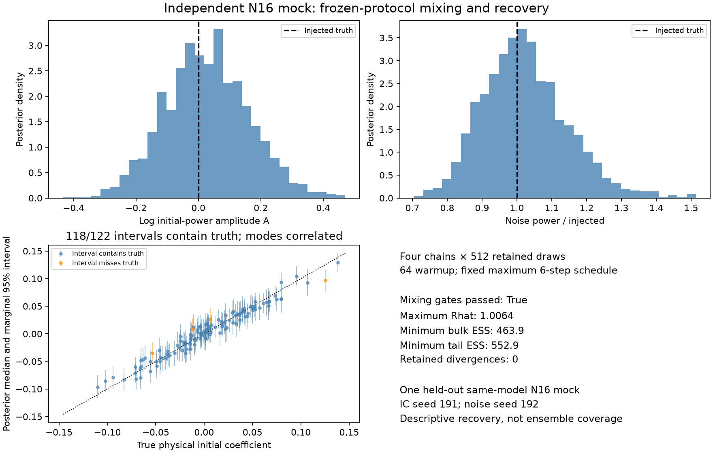

> Historical validation record. Original commands and full raw outputs are
> preserved in the [external archive](../../../ARCHIVE.md).

# Independent same-model N16 mock (#52)

The predeclared four-chain run has **mixing_passed=True** and
**consistency_passed=True**. Across all 248 monitored features,
maximum Rhat is 1.006393, minimum bulk ESS 463.91, and
minimum tail ESS 552.85. Retained divergences total
0. Failed checks: none.
The saved verdict remains passed=True; no thresholds or draw counts
were adjusted after seeing results.

## Frozen protocol and independent data

IC seed **191** and measurement-noise seed **192** replace the original 91/92.
Both generator and inference use N16 particles, M16 force grid and 16 time steps,
with the same fixed cosmology, 122 active real initial Fourier coefficients,
256 observed real degrees of freedom, reference power .002, true log-amplitude
A=0 and noise power 1e-4. The original validation used a refined N128 data
reference fitted at N16; this new same-model mock isolates inference from that
resolution mismatch. These datasets are not pooled for coverage or treated as
a same-target performance benchmark.

The sampler is frozen from the successful original case: four chains, 64 warmup
and **512 retained draws per chain**, maximum six leapfrog steps jittered 3..6,
initial step .25, warmup acceptance target .85, divergence threshold 10, and no
mass adaptation. All 2048 retained states enter every diagnostic. Prediction
stride 32 saves 16 latent predictions per chain; diagnostics are not thinned.
HMC/scalar seeds remain 12000..12003/23000..23003. Independent here refers to
the generated IC and noise, not to changing every random stream.

Initialization is a data-only joint MAP fit from an independent fixed start.
The new data-specific field metric is built and frozen before sampling; it is
not reused from the old data or adapted to the chain. This is the same metric
construction rule as before. The physical active-coordinate posterior retains
the 122*A/2 Jacobian and exactly integrates inactive Gaussian white directions.
The known truth is used for generation and reporting, not to initialize or fit
chains. MAP truth rows are bookkeeping only.

Strict criteria remain Rhat <1.05, bulk ESS >400 and tail ESS >200 for every
feature, mean field acceptance >.5 for every chain, and zero retained
divergences. A failing run stays failed. Intervals are exploratory if mixing
fails. A single truth falling outside a 95% interval does not itself constitute
a sampler failure or justify tuning.

## Recovery, separately from mixing

| Parameter | Truth | Posterior median | Marginal 95% interval | Contains truth |
|---|---:|---:|---:|---|
| A | 0 | 0.0254473 | [-0.229837, 0.295869] | True |
| N | -9.21034 | -9.19697 | [-9.41611, -8.95681] | True |
| noise_power | 0.0001 | 0.000101346 | [8.14019e-05, 0.000128856] | True |

The posterior mean initial field has correlation
0.97750 with truth and relative coefficient
error 0.21571.
118 of 122 physical coefficient
95% marginal intervals contain their true value. Those coefficients are
correlated: this descriptive count is **not an ensemble coverage estimate**.
Recovery is reported without introducing a one-mock coverage pass/fail gate.
The predictive discrepancy tail fraction is 0.5781
from 64 saved predictions and is also descriptive.



*Archived figure: Independent mock parameter traces and intervals (`pm_tsc_posterior_validation/independent_mock/analysis/parameters.png`). See [archive guide](../../../ARCHIVE.md).*

*Archived figure: Initial field reconstruction and uncertainty (`pm_tsc_posterior_validation/independent_mock/analysis/initial_fields.png`). See [archive guide](../../../ARCHIVE.md).*

*Archived figure: All-feature mixing diagnostics (`pm_tsc_posterior_validation/independent_mock/analysis/mixing.png`). See [archive guide](../../../ARCHIVE.md).*

## Engineering and replay

Fresh serial, slab-MPI, pencil-MPI and ASan/UBSan builds exercise generation,
seeded MAP/target/sampler plumbing, and collective input rejection. Slab and
pencil tests use 1/2/4 ranks. Checks separate IC from noise streams, repeat the
same mock exactly, reject wrong or inconsistent identities, and retain old
CLI behavior and default outputs bitwise. The full 512-draw science run uses
serial chains; small MPI checks establish backend agreement, not MPI posterior
mixing. The actual 16-step target, gradient and fixed-metric checks also pass.

Native generation, exported-noise normalization, raw feature reconstruction,
C++ rank diagnostics and saved analysis are independently replayed. The original
long-case analysis remains bitwise unchanged. The public benchmark comparator
rejects a cross-data comparison even with trajectory/budget exceptions enabled.
Production samplers and model defaults are unchanged; these seed and mock
controls belong to validation drivers.

```sh
python3 FML/FieldLevel/pm_tsc_posterior_validation/run_mock.py --bin-dir /path/to/binaries --output /fresh/MOCK --ic-seed 191 --noise-seed 192 --jobs 4 --timeout-seconds 7200
```

[Protocol (archived)](../../../ARCHIVE.md), [native commands (archived)](../../../ARCHIVE.md),
[summary and checks (archived)](../../../ARCHIVE.md),
[all-feature diagnostics (archived)](../../../ARCHIVE.md),
[generated truth (archived)](../../../ARCHIVE.md),
[raw chain 0 (archived)](../../../ARCHIVE.md),
[engineering (archived)](../../../ARCHIVE.md),
[input checks (archived)](../../../ARCHIVE.md),
[source hashes (archived)](../../../ARCHIVE.md), and
[replay evidence (archived)](../../../ARCHIVE.md) are retained.
Other chain files sit beside chain 0. See [the original longer validation](LONG_VALIDATION_RESULTS.md).

One held-out mock is a replication of the protocol, not repeated-mock coverage
or simulation-based calibration. N32 mixing, physical convergence, additional
signal/noise regimes, larger mock ensembles and a scalable full-grid metric
remain open. No broader #52 completion is claimed.
