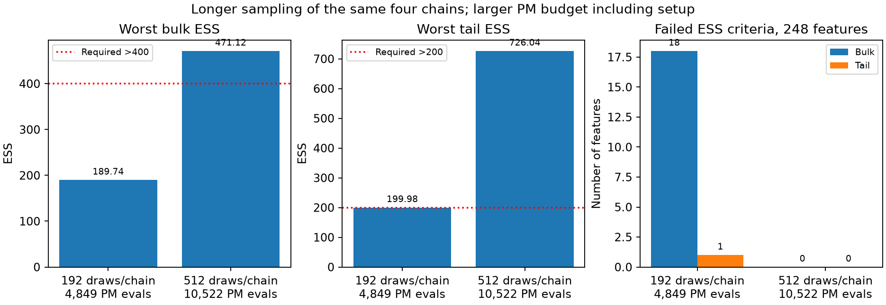

> Historical validation record. Original commands and full raw outputs are
> preserved in the [external archive](../../../ARCHIVE.md).

# Longer fixed-schedule N16 validation (#52)

This predeclared longer run **passes all original finite-chain mixing gates**
for all 248 monitored features: maximum Rhat 1.00707, minimum bulk ESS 471.12,
minimum tail ESS 726.04 and zero retained divergences. Acceptance is 0.864..0.913.
The raw and consistency checks also pass. This completes the bounded N16 mixing
milestone. N32 mixing, physical convergence and repeated-mock coverage remain open.

Four chains retain **512 draws each** after 64 warmup, using the same fixed
maximum 6-step schedule (jittered 3..6) as the
[192-draw pilot](INTERMEDIATE_RESULTS.md). The target, N16 particles/M16 force
mesh, 16 time steps, priors, 122 physical active coordinates and Jacobian, fixed
metric, seeds/starts and adaptation policy remain unchanged. Native code and
production defaults are unchanged.

The full report has passed=True, consistency_passed=True,
mixing_passed=True. Failed checks: none.
Every one of 2048 retained states, including repeated fields, enters all 248
feature diagnostics. No diagnostic thinning or post-warmup removal is used.

| Quantity | 192 retained draws/chain | 512 retained draws/chain |
|---|---:|---:|
| Actual PM forward/adjoint evaluations including setup/warmup | 4849 | 10522 |
| Maximum Rhat | 1.019325 | 1.007070 |
| Minimum bulk ESS | 189.74 | 471.12 |
| Minimum tail ESS | 199.98 | 726.04 |
| Features failing bulk ESS >400 | 18 | 0 |
| Features failing tail ESS >200 | 1 | 0 |
| All original mixing criteria passed | False | True |

Criteria stay Rhat <1.05, bulk ESS >400 and tail ESS >200 for every feature,
mean field-HMC acceptance >.5 per chain and zero retained divergences. Near
failures remain failed. Parameter intervals remain exploratory if these gates
fail. Passing finite-chain criteria alone does not establish repeated-mock
coverage, physical resolution convergence or N32 posterior mixing.



*Archived figure: Parameter traces and intervals (`pm_tsc_posterior_validation/long_validation/analysis/parameters.png`). See [archive guide](../../../ARCHIVE.md).*

## Larger budget, fixed algorithm

The actual total PM cost ratio is **2.1699**.
This is a predeclared larger-budget validation with the same sampler, not a
matched-budget algorithm improvement. Each campaign computes a fresh metric
with 252 evaluations charged once. Metric hashes match exactly. The 64 warmup
iterations, initial step .25, target acceptance .85, divergence threshold 10 and
fixed mass stay unchanged. Retained draws are fixed at 512 before sampling;
there is no extension until a gate passes.

Prediction stride 32 saves 16 predictions per chain, matching the pilot's stride 12
and 16 saves. Prediction stride does not thin the diagnostic states. Predictive-only
forwards are excluded equally from cost accounting. The extra sample count also
amortizes fixed warmup/setup; an ESS-per-cost change is not evidence for a new kernel.

Same seeds and starts reproduce the pilot's first 192 state/feature rows exactly,
as checked in [the prefix evidence (archived)](../../../ARCHIVE.md). Added
samples extend the same four chains; the runs are not independent replications.
The comparison keeps shared target, metric, metadata and convergence checks.
Larger budgets require both explicit trajectory-change and budget-change flags;
the default 5% matched-budget guard still rejects over-budget comparisons.

## Validation and reproducibility

The native binary and source hashes remain unchanged from earlier serial,
slab/pencil MPI, ASan/UBSan and analytic Gaussian checks. Native target/gradient/
Jacobian and fresh metric checks run again. Raw feature reconstruction, C++ rank
diagnostics, copied-report analysis, source hashes, prefix agreement and setup
accounting are replayed. Budget/metadata refusal checks pass; an explicit budget
flag accepts larger cost while still rejecting a changed target.

The runner's timeout cap increases to 7200s per child, preserving its default;
the old 3600s cap was close to this roughly hour-long case. This changes only the
run deadline, with retained count and sampler settings fixed in advance.

```sh
python3 FML/FieldLevel/pm_tsc_posterior_validation/run.py --bin-dir /path/to/binaries --output /fresh/LONG --scheme preconditioned --draws 512 --leapfrog 6 --predictive-stride 32 --timeout-seconds 7200
python3 FML/FieldLevel/pm_tsc_posterior_validation/compare.py --baseline /MID --candidate /LONG --output /COMPARE --allow-trajectory-change --allow-budget-change
python3 FML/FieldLevel/pm_tsc_posterior_validation/long_validation/overview.py --root FML/FieldLevel/pm_tsc_posterior_validation --output /OVERVIEW
```

[Protocol (archived)](../../../ARCHIVE.md), [commands (archived)](../../../ARCHIVE.md),
[raw states (archived)](../../../ARCHIVE.md),
[all-feature diagnostics (archived)](../../../ARCHIVE.md),
[summary and failure flags (archived)](../../../ARCHIVE.md),
[comparison (archived)](../../../ARCHIVE.md),
[control checks (archived)](../../../ARCHIVE.md),
[compiled source hashes (archived)](../../../ARCHIVE.md),
[prefix checks (archived)](../../../ARCHIVE.md) and
[replay evidence (archived)](../../../ARCHIVE.md) are retained.
All other chain files sit beside chain0. See [README](README.md) for context.

This remains one finite N16 realization. N32 mixing, different signal/noise
regimes, particle refinement and repeated-mock coverage remain outside scope.
The dense small active-space metric is not a full-grid production preconditioner.
