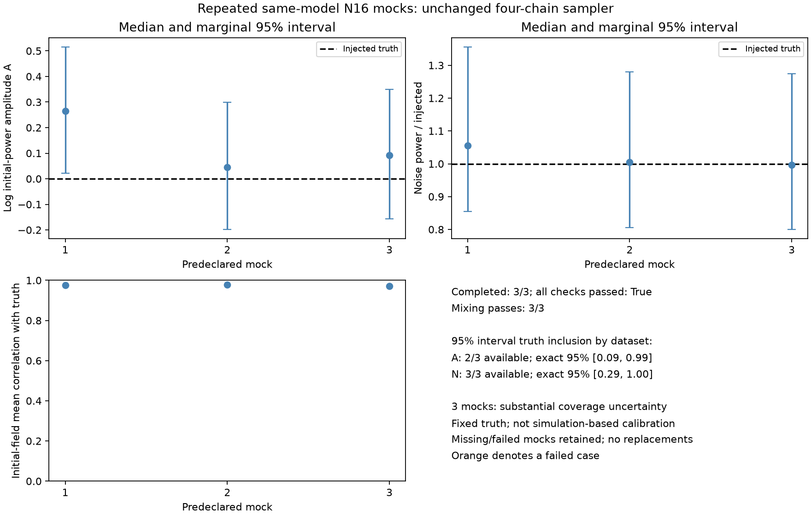

> Historical validation record. Original commands and full raw outputs are
> preserved in the [external archive](../../../ARCHIVE.md).

# Repeated same-model N16 mocks (#52)

**3/3 mocks completed; 3/3 pass the unchanged
mixing criteria and 3/3 pass consistency checks.**
The sampling/consistency verdict is passed=True. Every participating mock is retained,
including missing or failed results. The originally planned fourth mock is
recorded as user-skipped, separately from scientific failures. No draw extensions, replacements, sampler
retuning or relaxed thresholds are used.

## Original plan and user-requested scope amendment

The original plan declared **291/292, 391/392, 491/492 and 591/592**. After the
first two results were known and the third was running, the user requested
skipping the fourth. The effective sample contains **three** datasets; 591/592
was never generated. [The scope amendment (archived)](../../../ARCHIVE.md)
preserves that timing and reason alongside the unchanged original plan.
The earlier 191/192 mock is historical evidence, excluded from this three-dataset
sample. Generator and inference both use N16 particles, M16 force mesh, 16 time
steps, 122 active real initial coefficients and 256 observed real degrees of
freedom. Fixed true log-amplitude A=0, noise power=1e-4 and reference power=.002
are unchanged. The initial field and noise are regenerated independently for
each dataset. This tests repeated-data recovery at fixed hyperparameters,
**not prior-predictive simulation-based calibration**.

Each mock gets a data-only joint MAP initialization and fresh data-specific
metric constructed under the existing rule, then frozen before sampling. Four
chains each run 64 warmup plus 512 retained draws, with maximum six leapfrog
steps jittered 3..6, initial step .25, warmup target .85, divergence threshold 10,
no mass adaptation, and prediction stride 32. HMC/scalar seeds remain fixed at
12000..12003/23000..23003. Only four native chains run concurrently. Native
binaries and driver hashes are recorded and checked before each mock.

All 2048 retained states per completed mock enter all 248 diagnostics. No
cross-dataset chain pooling or diagnostic thinning occurs. Criteria remain
Rhat <1.05, bulk ESS >400 and tail ESS >200 for every feature, mean acceptance
>.5 per chain, and zero retained divergences. Sampling uses physical active
coordinates with the 122*A/2 Jacobian and exactly marginalized inactive white
Gaussian directions. Known truth is used for generation and reporting, never
for MAP initialization or chain fitting.

## Results by independent dataset

| Mock | IC/noise seeds | All checks pass | Max Rhat | Min bulk / tail ESS | A 95% interval | Noise/injected 95% interval | Field correlation |
|---|---|---|---:|---:|---|---|---:|
| 1 | 291/292 | True | 1.00743 | 454.8 / 552.1 | [0.021, 0.516] | [0.855, 1.356] | 0.9768 |
| 2 | 391/392 | True | 1.00626 | 530.2 / 826.5 | [-0.198, 0.298] | [0.806, 1.281] | 0.9770 |
| 3 | 491/492 | True | 1.00648 | 532.2 / 712.6 | [-0.157, 0.349] | [0.800, 1.274] | 0.9700 |



[The complete summary (archived)](../../../ARCHIVE.md) includes individual
failed checks, divergence counts, acceptance, field error, mode-interval counts
and predictive discrepancy. [The table (archived)](../../../ARCHIVE.md) is
machine-readable. Each mock folder retains all raw chains, native diagnostics,
truth/data, target checks, metric, commands and per-dataset analysis plots.
An incomplete case retains its preflight record and native outputs.

## What this small sample can establish

- A: 2/3 available intervals include truth; 0 missing out of 3 participating datasets. Exact binomial 95% interval for inclusion fraction: [0.094, 0.992]; original Wilson bounds [0.208, 0.939].
- N: 3/3 available intervals include truth; 0 missing out of 3 participating datasets. Exact binomial 95% interval for inclusion fraction: [0.292, 1.000]; original Wilson bounds [0.439, 1.000].

Observed scalar interval misses: A in mock 1. These remain in every table and denominator.

These are small-sample descriptive counts, not a coverage success criterion.
The scope was reduced after partial results were known. Both interval methods
provide nominal fixed-sample descriptive bounds, not an optional-stopping coverage guarantee.
Conservative exact binomial bounds supplement the original Wilson approximation
because the remaining sample is very small; neither interval is a pass/fail gate.
Even all intervals containing truth leave a broad interval for the true inclusion probability.
A single missed 95% interval is not a sampler failure. Any missing/non-mixing
case makes the available-interval estimate unreliable; failures are not dropped
from the declared sample. N and noise-power inclusion are the same event under
a monotone transformation, and A/N results on the same datasets are correlated.
The 122 initial coefficients within a dataset are also correlated, so their
counts are never pooled into an independent binomial sample. Wilson intervals
use independent datasets and omit residual Monte Carlo error. Mixing diagnostics
are finite-chain checks, not a proof of exact posterior sampling.

This improves on the earlier one-mock check by repeating the frozen procedure on
new data. This small fixed-truth sample does not calibrate the full prior, other
cosmologies, signal/noise regimes or survey likelihoods. The old refined-data
case has a different generator discretization and is not pooled with this
same-model campaign. N32 mixing, physical resolution convergence, a larger
calibration ensemble and scalable production metrics remain open.

## Validation and replay

The pilot buffers retained states until a chain completes and does not expose
a mid-chain restart checkpoint. Finished mocks and complete chains are saved;
interrupted unfinished chains must be restarted with the same seeds and controls.
No native source or production sampler change is made for this campaign.
The active orchestrator had no queue-cancellation hook. A comment-only source
marker deliberately triggered its next pre-launch provenance guard after the
third mock finished, preventing the fourth launch without interrupting native
sampling. Its original source was restored after parent exit. This expected
control stop is recorded separately from the three per-mock verdicts. The
aggregate analyzer was amended to honor the user-requested skip; original and
amended analysis sources/hashes are retained. The
serial binaries match those validated on slab/pencil MPI 1/2/4 ranks and under
ASan/UBSan in the independent-mock task. Actual science chains are serial.
Synthetic reporting controls verify failure retention, missing denominators,
truth-inclusion/mixing separation, seed mismatch rejection and Wilson bounds.
Each completed mock is replayed for generation, raw features, C++ diagnostics
and analysis; aggregate analysis is also replayed. Native source/driver hashes
are checked. The earlier independent/long reports are preserved.

```sh
# Original four-mock protocol (saved campaign was reduced to three):
python3 FML/FieldLevel/pm_tsc_posterior_validation/run_mocks.py --bin-dir /path/to/binaries --output /fresh/REPEATED
# Reanalyze the saved three-mock run, reading its scope amendment:
python3 FML/FieldLevel/pm_tsc_posterior_validation/analyze_mocks.py --input /saved/REPEATED --output /fresh/ANALYSIS
```

[Predeclared plan (archived)](../../../ARCHIVE.md),
[campaign commands (archived)](../../../ARCHIVE.md),
[native source hashes (archived)](../../../ARCHIVE.md),
[driver hashes (archived)](../../../ARCHIVE.md),
[synthetic reporting checks (archived)](../../../ARCHIVE.md), and
[replay checks (archived)](../../../ARCHIVE.md) are retained.
See [the independent-mock report](INDEPENDENT_MOCK_RESULTS.md) for backend validation.
