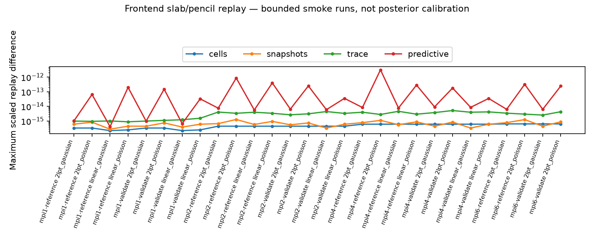

# Slab/pencil frontends and validation outputs — step 4

14 November 2026. The four distributed examples and both survey-validation
executables now select FFTWGrid or PencilGrid at build time. The distributed
framework port covers its four planned steps; this is bounded engineering
verification, not a new posterior calibration campaign.

## Build and runtime coverage

Eighteen executables build through the actual Makefiles in isolated directories:
`framework_mpi`, `checkpoint_mpi`, `survey_mpi`, `survey_checkpoint_mpi`,
`survey_validate`, `survey_reference`, each in Clang 17 serial, MPI slab, and MPI
pencil configurations. MPI uses a matching Open MPI FFTW build; OpenMP uses two
threads and FFTW threading is disabled. FFTWGrid bounds checks are enabled.

- Complete linear framework examples run in all three build configurations.
- Complete 2LPT framework and Gaussian/Poisson survey examples run on four pencils.
- Periodic and Gaussian/Poisson checkpoint examples start/resume in separate
  processes in all three configurations, with extra four-rank 2x2 survey restarts.
  Their per-job budgets are bounded; full trajectory continuation was validated
  separately in [step 3](SURVEY_GRID_RESULTS.md).
- Independent active-mode reference checks pass at 1/2/4/6/8 ranks and on explicit
  1x4 and 4x1 process grids. These check projection, prior accounting, posterior
  gradients and the dense reference momentum/inverse metric.
- Invalid pencil products, trailing environment tokens and non-MPI pencil builds
  are rejected. Domain parsing and rank agreement occur before grid construction.

`USE_PENCIL_GRID=true` requires MPI; the normal default remains slabs.
`FML_PENCILS="px py"` chooses a process grid, with omitted values supplied by
MPI_Dims_create. Boundaries are cell-aligned on both meshes, using their greatest
common divisor. The initial/density-mesh and nonempty Fourier constraints remain.
Frontends report the backend/shape, and driver metadata stores backend, rank count
and process-grid dimensions. Clean when switching compiler/backend/MPI flags.

## Bounded end-to-end replay

The smoke runner executes linear/2LPT x Gaussian/Poisson in full-grid production
and exact active-mode representations: two chains, four warmup steps, 16 draws,
two leapfrog steps and fixed step size 0.01, with step/mass adaptation disabled.
It compares **within each representation**, not full-grid draws against collapsed
active draws (those use different masses and latent dimensions).

Eight serial baseline cases are compared with 24 pencil cases on 1/2/4 ranks.
Four further nonlinear cases on 6 ranks exercise unequal 3x2 pencils, including
snapshot boxes with unequal local lengths. All **28 replay comparisons** pass.
Errors are `abs(a-b)/max(1,abs(a),abs(b))` over the complete saved arrays:

| Output | Maximum comparison error |
| --- | --- |
| Canonically ordered cells: mask/selection/variance/exposure/data/holdout/truth | 6.39e-16 |
| Reassembled predictive-mean snapshots | 1.28e-15 |
| Mode/probe/norm/potential traces | 5.22e-15 |
| Predictive statistics | 3.14e-12 |

These fixtures have no divergences. Short-run mixing diagnostics remain in the
output and do not establish convergence. Native completion is explicitly SMOKE;
metadata marks it, and the scientific calibration analyzer rejects smoke inputs.
Normal campaigns retain their original schedules and convergence thresholds.
The replay threshold is 2e-8; no general bitwise trajectory agreement is promised.



## Snapshot schema and backward compatibility

The driver now writes validation snapshot **schema 2**, containing all per-axis
start/count ranges; TSV labels and RNG keys use global cell IDs. The reader
reassembles noncontiguous y-split boxes into canonical global order and rejects
missing/overlapping coverage, wrong lengths, duplicates and truncated streams.
Standalone reader checks exercise legacy slabs, whole boxes, y-split boxes,
missing coverage, overlaps and truncation.

The updated reader also reproduces two actual archived schema-1 datasets bit for
bit: a 500x512 one-rank linear reference snapshot array and a 200x512 two-rank
nonlinear Gaussian array. Archived scientific results/figures were preserved.
This output schema is separate from checkpoint target schema 3; checkpoint
migration across backends/layouts is still unsupported.

## Reproduction and scope

See [frontend selection](../../FRAMEWORK.md#frontend-backend-selection-step-4-14-november-2026)
and [the validation guide](../studies/survey_validation/README.md). A short replay uses:

```sh
python3 FML/FieldLevel/survey_validation/run.py --smoke \
  --bin-dir /path/to/serial-build --mpi-bin-dir /path/to/pencil-build \
  --output /fresh/output --mpirun mpirun --mpi-ranks 1 2 4
```

The runner hashes both serial and MPI executables, records commands/statuses and
writes a JSON report plus PNG/PDF. Set matching compiler/MPI/FFTW paths at build
time. MPI process-grid overrides are available for direct executable invocations.
The convergence scan retains its single-rank fixture contract; its model and
coordinate code now use the selected backend, but that full scan was not rerun
for this port.

The normal scientific campaign can run with either backend. Its historical
coverage/mixing/selection measurements remain the original slab evidence; the
full campaign was not rerun on pencils here. Original serial BAO/reference APIs
remain single-rank. Checkpoint repartitioning, cached pencil transfer plans,
performance/scaling measurements and broader calibration remain follow-ups.
No speedup, peak-memory or production scientific-calibration claim is made.
