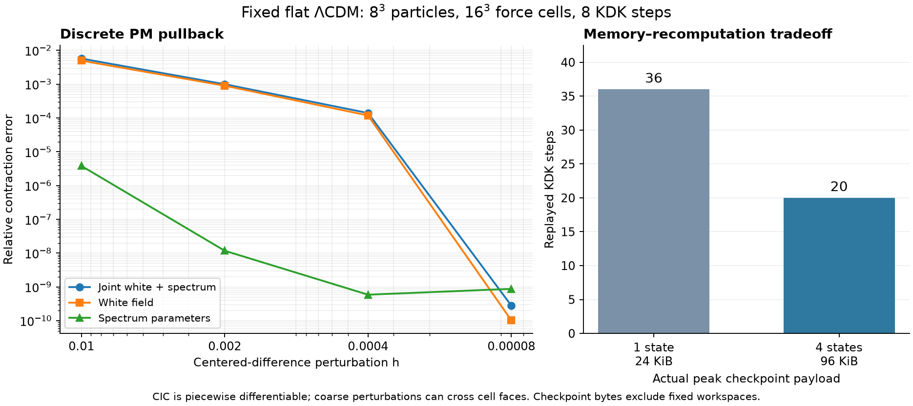

# PM discrete-adjoint validation (14 November 2026)

[ParticleMeshAdjoint.h](../../../ParticleMeshAdjoint.h) differentiates the fixed-background
PM map. [The API guide](../../PM_ADJOINT.md) specifies real-space cotangents, globally
reduced spectrum gradients and checkpoint/replay conventions. This milestone does
not add a PM likelihood or posterior.

## Derivative checks

Each reverse contraction is compared with a centered finite-difference approximation
to the forward directional derivative, sweeping h=0.01, 0.002, 0.0004, 0.00008.
Directions cover the white field, the two spectrum parameters (amplitude and tilt),
and joint variations. Separate covectors isolate initial density, final CIC matter
density, displacement and canonical momentum. Additional checks probe three
individual global white cells and both spectrum components. The scalar objective
uses explicit compact-array Euclidean sums and MPI reductions, so the tests also
check Hermitian/Fourier normalization and the single scalar-gradient reduction.

The largest best-step relative contraction error across all recorded directions,
backends, rank/thread and sanitizer runs is **5.56e-9** (test threshold 8e-6).
The full slab joint contraction reaches about 2.82e-10 in serial. These are numerical
transpose checks using finite-difference J*v; no independent analytic tangent/JVP
implementation is claimed.

The fixtures use a nonzero seeded white field, band-limited spectrum and all output
covectors; they are not zero-field identities. Main runs use flat Omega_m=0.3,
8^3 particles, 16^3 force cells and eight intervals over a=0.2..0.6. An EdS 4^3
particle/force case uses four intervals. The unequal pencil case uses 10^3 particles
and 20^3 force cells. Initial spectrum normalization is at a=1 as in the forward API.

CIC is only piecewise differentiable. Coarser perturbations can cross cell faces
along the trajectory, so global h^2 finite-difference convergence is not expected.
The fine-step checks resolve the selected branch. This is not a claim about a unique
derivative at exact assignment faces or production HMC mixing near such faces.

## Checkpoint tradeoff and lifecycle

The same gradient passes with zero, one and four additional midpoint slots. Tests
assert the actual retained-state bound, checkpoint bytes and equality within 2e-12.
For the eight-step main fixture:

| Additional midpoint slots | Peak retained states (including initial) | Checkpoint payload on one rank | Replayed KDK steps |
|---|---:|---:|---:|
| 0 | 1 | 24 KiB | 36 |
| 4 | 4 | 96 KiB | 20 |

The four-step case uses 10 versus 8 replayed steps and one versus three retained
states. Counts include the forward replay of each reversed step and exclude the
original forward evaluation. These logical work counters are not timing results;
additional primal and transposed FFT operations are documented separately. Payload
bytes exclude the fixed scratch/forward workspaces, cotangents, old-position buffer,
FFT/transport overhead and allocator retention. Scalar schedules/diagnostics remain
linear in node count; no particle/grid tape is stored.

Tests also verify cached input ownership after callers mutate their input arrays,
unchanged public forward outputs after repeated pullbacks, exact zero gradients for
empty cotangents, independent rank-local omitted fields, pre-forward rejection,
wrong/nonfinite local covectors, invalid budgets and cross-rank budget disagreement.
The forward workspace now caches one extra local white field and scalar parameter
vector; that cost is explicit rather than included in checkpoint payload bytes.

## Builds and parallel evidence

All final binaries were clean-built with actual Makefiles in isolated directories,
C++17, double precision, bounds checks and no GSL. Clang 17 uses matching Open MPI
and FFTW-MPI for distributed runs, with separate serial FFTW. Controlled runs use
1 or 2 OpenMP threads and passive waiting; FFTW threading is disabled.

| Configuration | Passed checks |
|---|---:|
| Serial, 2 OpenMP threads | 35 |
| MPI, 1 rank / 2 threads | 61 |
| MPI, 2 ranks / 2 threads | 62 |
| MPI, 4 ranks / 2 threads | 87 |
| MPI, 4 ranks / 1 thread | 87 |
| Clang 20 ASAN + UBSAN, serial | 35 |

The MPI runs compare slabs with x-pencils and y-pencils; the four-rank run also
compares 2x2 pencils and exercises unequal N10/force-N20 boxes. The largest backend
objective/gradient discrepancy in these fixtures is below 3.30e-17. Canonical serial
versus MPI rank/thread snapshots agree within **2.95e-17**; Clang 20 sanitizer
snapshots are bitwise equal to serial in this fixture. This is not a general bitwise
reproducibility promise. Leak detection is disabled for the sanitizer run.

The registered `particle-mesh-adjoint` Make target passes at 1/2/4 ranks. Standalone
serial and four-rank 2x2-pencil sensitivity examples pass. The complete earlier PM
forward tests were rebuilt and rerun in serial and four-rank MPI; their canonical
snapshots are **bit-for-bit unchanged** from the previous milestone. Earlier review
artifacts and their binaries were not overwritten. Full library CI was not rerun.



## Reproduction and limits

```sh
make -C FML/FieldLevel/tests clean
make -C FML/FieldLevel/tests particle-mesh-adjoint USE_MPI=true NP_LIST="1 2 4"
mpirun -np 4 FML/FieldLevel/tests/test_particle_mesh_adjoint /tmp/pm_adj.csv
```

The CSV contains the actual directional step sweeps; the accompanying `.snapshot`
file stores a root-only canonical objective/white gradient/spectrum gradient.
Machine-specific commands, copied build sources, frozen sources and hashes, replay
comparisons, PNG/PDF figures and combined/incremental review patches are preserved
in `outputs/fml-fieldlevel-pm-step2/`. Earlier exploratory checks are separate.

The background, time nodes and kernel remain fixed. No total-memory/scaling,
optimal checkpoint scheduling, PM posterior calibration, cosmological-parameter
sensitivity, survey/tracer/RSD likelihood, disk restart or analytic tangent API is
claimed. Next: periodic likelihood/MAP integration, then bounded HMC experiments.
