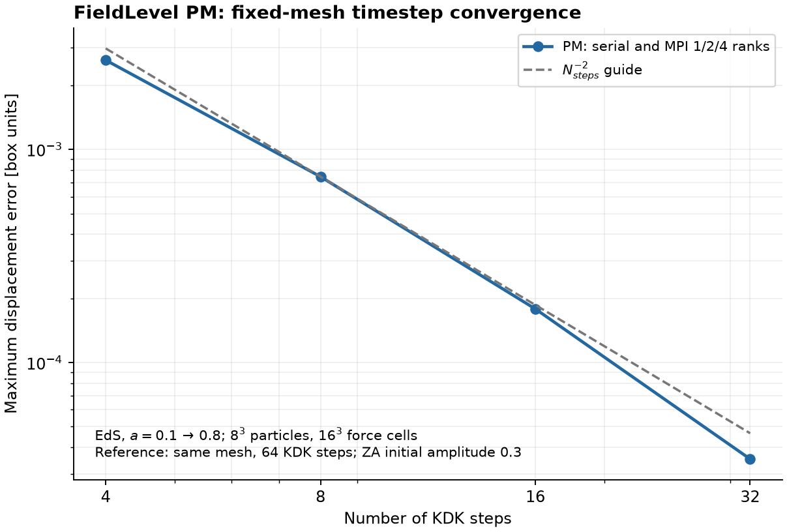

# PM forward milestone: bounded validation (14 November 2026)

`../ParticleMesh.h` is a forward-only periodic PM map, not a PM posterior.
[The guide](../../PARTICLE_MESH.md) specifies units, dynamics, ownership and limits.
The default `particle-mesh` test target is registered in `run`; native NBody
comparison additionally compiles when `USE_GSL=true`.

## Numerical evidence

- An independent analytic three-axis ZA start plus dense CIC/direct DFT EdS
  evolution matches final displacement, canonical momentum and density to
  **1.23e-15** maximum absolute error. It uses a 4^3 particle/force mesh and
  three KDK intervals. It shares no deposition, Poisson, FFT or gather code
  with the forward model.
- A separate native pipeline uses migrating `MPIParticles`, native CIC assignment,
  native continuous spectral forces, `KickParticles` and `DriftParticles`. Its
  final wrapped positions, momenta and density agree to **2.90e-12** at each of
  1/2/4 ranks. This comparison uses fixed Omega_m=0.3, 8^3 particles, 16^3 force
  cells, eight intervals and a three-axis amplitude-0.3 initial density. It shares
  the background quadrature and growing-mode IC generator; the dense EdS test
  independently anchors the time factors and initial displacement signs.
- At each node, test trajectories conserve mean mass and total canonical
  momentum within 1e-12. A uniform coincident particle/force lattice is exactly
  stationary to the 1e-14 test threshold. The momentum test applies to the
  periodic self-force with the matched deposition/gather and antisymmetric kernel.
- Flat LCDM growth at a=0.1 and growth rate at a=1 agree with separately evaluated
  high-accuracy integrals (0.12831843154454436 and 0.512796247730238 respectively).
  EdS growth/rate are exact; LCDM growth is normalized at a=1.
- Spectrum amplitude scaling is checked separately; only the spectrum parameters
  are exposed by this forward API.

## Parallel, lifecycle and safety checks

Clean actual-Makefile builds used Clang 17, double precision, bounds checks and
2 OpenMP threads (passive waiting), matching Open MPI/FFTW-MPI and separate serial
FFTW. Serial tests passed **20 checks**. MPI runs at 1/2/4 ranks passed
**43/45/68 checks**; a separate four-rank one-thread run passed 68 checks.
The MPI builds enabled the optional GSL/native comparison; the serial build and
both standalone examples demonstrate the GSL-free production header.

Within each MPI run the x-pencils, y-pencils and (four ranks) 2x2 pencils agree
with slabs. The four-rank run also exercises unequal N=10/force-N=20 boxes.
Canonical snapshot comparisons across serial, 1/2/4 ranks and 1/2 threads have
maximum absolute discrepancy **1.25e-14**. These are fixture comparisons, not a
promise of bitwise reproducibility for every mesh/build or MPI reduction order.

Tests check repeated-call exact reset, moved workspaces, foreign-workspace
rejection, use of the copied domain after changing FML's global domain, separate
particle/density layout sizes, result invalidation after failure, one-rank malformed
and nonfinite initial fields, invalid spectrum parameter dimensions, invalid
background/schedule, rank-dependent controls and misaligned force-mesh edges.

The full serial suite also passed Clang 20 address/undefined sanitizers with
bounds checks (**20 checks**, leak detection disabled). Clang 17's combined
sanitizers reported a function-pointer-type diagnostic inside libc++'s
`std::variant` domain dispatcher. A probe containing only the existing distributed
linear/LPT headers and no PM header reproduces that diagnostic category; a simpler
Global/Domain-only probe does not. The Clang 17 sanitizer result is retained as
an unresolved shared/toolchain limitation, not counted as a pass or suppressed.
No shared domain code was changed. Clang 20 sanitizer output matches serial
snapshots exactly in this fixture.

Standalone serial and four-rank 2x2-pencil examples pass. Full library CI was not
rerun for this additive milestone; the previous CI's unrelated blockers are not
changed by it.

## Timestep experiment

At fixed 8^3 particle/16^3 force resolution, EdS a=0.1 to 0.8 and ZA amplitude 0.3,
the maximum displacement errors against a 64-step trajectory are:

| KDK steps | Maximum displacement error (box units) |
|---|---:|
| 4 | 2.62317e-3 |
| 8 | 7.44441e-4 |
| 16 | 1.78364e-4 |
| 32 | 3.52112e-5 |

The successive reductions are 3.52, 4.17 and 5.07, consistent with second-order
refinement and a finite-step reference. Serial/MPI/thread/sanitizer runs agree
in this experiment. This is temporal convergence of the discrete PM map, not
mesh convergence to collisionless continuum dynamics or cosmological calibration.



## Reproduction and remaining work

```sh
make -C FML/FieldLevel/tests clean
make -C FML/FieldLevel/tests particle-mesh USE_MPI=true USE_GSL=true NP_LIST="1 2 4"
# Passing a CSV path also runs the optional timestep experiment and exports
# a root-only canonical snapshot alongside it, with suffix .snapshot:
mpirun -np 4 FML/FieldLevel/tests/test_particle_mesh /tmp/pm_steps.csv
```

Machine-specific build/run logs, copied sources, source/binary hashes, comparison
arrays and review diff are preserved in the local `outputs/fml-fieldlevel-pm-step1/`
review bundle. Early exploratory failures are distinct from final validation.
No performance/scaling, peak-memory, high-redshift radiation, halo-scale accuracy,
production survey inference or PM derivative claim is made. Next: discrete reverse
map and bounded checkpoint/recomputation, then MAP and small HMC experiments.
