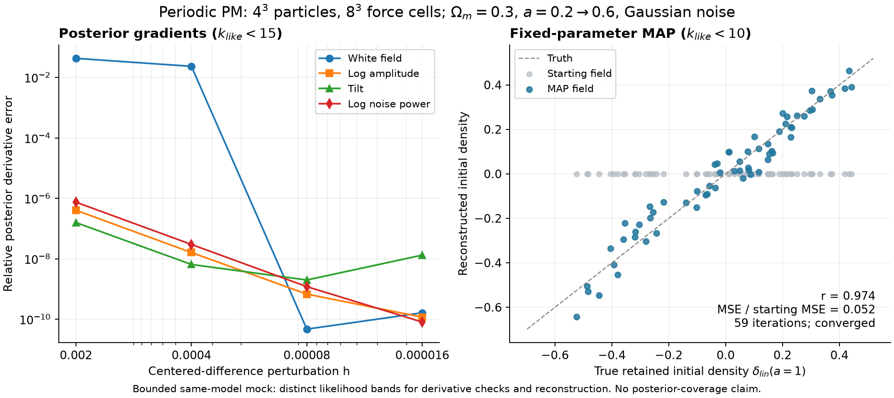

# Periodic PM Gaussian posterior / MAP validation (14 November 2026)

[ParticleMeshPosterior.h](../../../ParticleMeshPosterior.h) connects PM to the existing
Gaussian Fourier likelihood, priors and MAP optimizer. [The guide](../../PM_POSTERIOR.md)
explains IC/observation meshes, normalization, gradient reductions and limits.
The main fixtures use 4^3 particles, 8^3 force cells, flat Omega_m=0.3, four KDK
intervals over a=0.2..0.6 and an initial spectrum defined at a=1.

## Posterior and noise checks

Full posterior finite differences sweep h=0.002, 0.0004, 0.00008, 0.000016 for a
white-field direction and each log-amplitude, tilt and log-noise parameter. Checks
include the white prior, all scalar priors, full-Hermitian weights and the
parameter-dependent noise normalization. The largest best-step relative error
across final rank/backend/thread/sanitizer cases is **2.71e-9** (threshold 1e-5).
The derivative fixture uses initial cutoff 10 and likelihood cutoff 15, including
PM-generated modes strictly above the IC Nyquist 4*pi and below the force Nyquist.
CIC cell-face crossings affect coarser white-field perturbations; the fine steps
resolve a branch. Smooth scalar directions show the expected finite-difference
refinement until rounding dominates.

The Fourier prediction is independently summed from the final real force-grid
field; the deterministic noise is independently generated from global IDs and
summed by direct DFT, checking variance P_noise/V. Both checks pass a 2e-13 maximum
absolute threshold. An independent explicit likelihood/prior sum agrees with the
posterior value within 2e-11. A physical-unit rescaling doubles box length, halves
wave-number cutoffs and multiplies signal/noise powers by eight (including noise
prior bounds/mean). It preserves the posterior and gradients within 2e-9, providing
an additional non-unit-volume normalization check.

The normalized likelihood is reused directly. The PM pullback's global spectrum
derivatives enter the generic posterior reduction on rank zero only; noise
contributions are local until that reduction, and priors are added once. Scalar
finite differences on 1/2/4 ranks explicitly test this convention.

Malformed local states/data, rank-dependent noise priors, invalid noise priors,
and out-of-support proposals are rejected. The explicit identity white-field
metric is checked. A compile-only negative test confirms the generic Cartesian
survey factory is deleted for this two-mesh model, rather than misindexing force
modes on the IC grid. PM restart identity is not integrated.

## Bounded mock reconstruction

A distinct conservative-band experiment uses likelihood cutoff **10**, equal to
the retained initial support. Spectrum and noise parameters are held fixed and
the near-zero starting white field is optimized with the existing backtracking
MAP routine. The data are an independent-noise draw from the same PM model.
The recovered field is the retained initial-density band; unconstrained white
directions remain prior-driven.

| Quantity | Result |
|---|---:|
| Initial posterior potential | 102.2638722053 |
| Final posterior potential | -71.9655579075 |
| MAP iterations | 59 |
| Status | Converged |
| Final white-gradient infinity norm | 1.65167e-5 (tolerance 2e-5) |
| Initial-density squared error / starting squared error | 0.0515657 |
| Truth/reconstruction correlation | 0.974060 |

A separate eight-iteration joint run lowers the posterior and changes the
spectrum/noise parameter vector within prior bounds. This checks joint optimization
plumbing; it does not establish joint convergence or parameter recovery.

One earlier cutoff-14 experiment improved the reconstruction but stopped at a
line-search limit (37 iterations, gradient norm about 0.0112). It is retained in
`exploratory.log` and is not counted as convergence. Separate cutoff 8/10/12/15
probes converged, showing that optimization behavior depends on the selected
modes/noise target. No universal short-wave cutoff rule or sole cause of the
stalled run is inferred. CIC's piecewise derivatives and identity-preconditioned
backtracking remain limitations for wider production targets.

## Parallel and build evidence

All final binaries are clean actual-Makefile C++17 double-precision builds with
bounds checks and no GSL. Distributed builds use matching Open MPI/FFTW-MPI,
serial builds use separate FFTW; FFTW threading is disabled. Controlled tests use
1/2 OpenMP threads with passive waiting. Clang 17 builds the normal matrix and
Clang 20 runs ASAN/UBSAN (leak detection disabled).

| Configuration | Passed checks |
|---|---:|
| Serial, 2 threads | 19 |
| MPI 1 rank, 2 threads | 38 |
| MPI 2 ranks, 2 threads | 39 |
| MPI 4 ranks, 2 threads | 53 |
| MPI 4 ranks, 1 thread | 53 |
| Serial Clang 20 ASAN + UBSAN | 19 |

The MPI runs compare slabs/pencils; four ranks use 2x2 pencils and additionally
check an unequal 10^3 IC / 20^3 force-mesh posterior. Backend comparisons include
predictions, seeded mocks, posterior value, white/scalar gradients and MAP fields.
Canonical cross-rank/thread snapshots agree within **1.43e-13** maximum absolute
difference, including the two target values and reconstruction; sanitizer snapshots
match serial exactly in this fixture. This is not a general bitwise guarantee.

The registered `particle-mesh-posterior` target passes at 1/2/4 ranks. Standalone
serial and four-rank 2x2-pencil MAP examples converge in 59 iterations. Earlier PM
forward/adjoint sources and review bundles are preserved unchanged; the shared
likelihood, optimizer and sampler implementations are unchanged. Full CI was not
rerun for this additive increment.



## Reproduction and remaining scope

```sh
make -C FML/FieldLevel/tests clean
make -C FML/FieldLevel/tests particle-mesh-posterior USE_MPI=true NP_LIST="1 2 4"
mpirun -np 4 FML/FieldLevel/tests/test_particle_mesh_posterior /tmp/pm_post
```

The optional prefix writes `.gradients.csv`, `.fields.csv` and `.snapshot` files.
The snapshot includes the cutoff-15 derivative-target value and cutoff-10 MAP value;
compare within each experiment, not those two values against each other. Frozen
sources, build/command logs, scalar summaries, complete/incremental patches and
PNG/PDF plots are in the local `outputs/fml-fieldlevel-pm-step3/` review bundle.

These are bounded same-model checks with one recovery mock, not posterior coverage,
mesh/particle convergence or cosmological calibration. Next: small PM HMC experiments
with explicit step-size, divergence, mixing and reconstruction diagnostics. Smooth
assignment alternatives, better PM metrics/optimization, PM-specific checkpoint
fingerprints, survey/tracer/RSD models and cosmological derivatives remain open.
