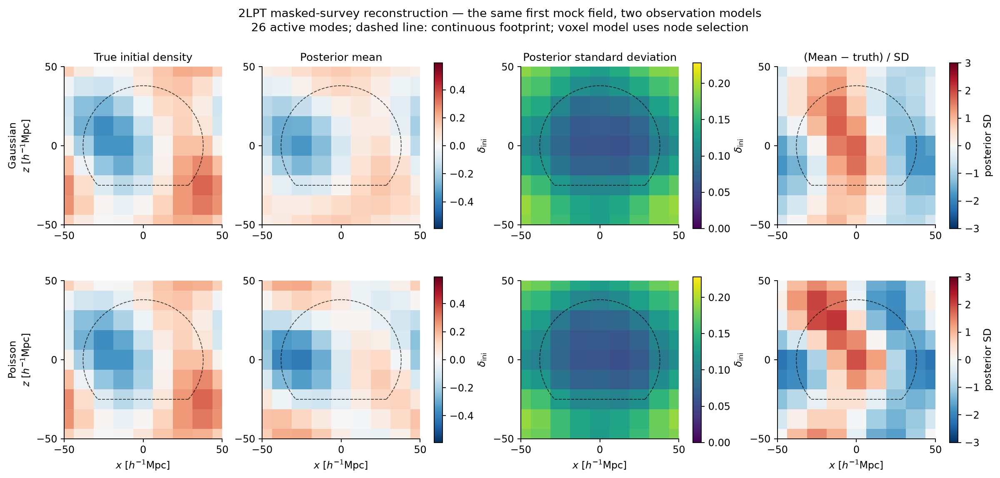
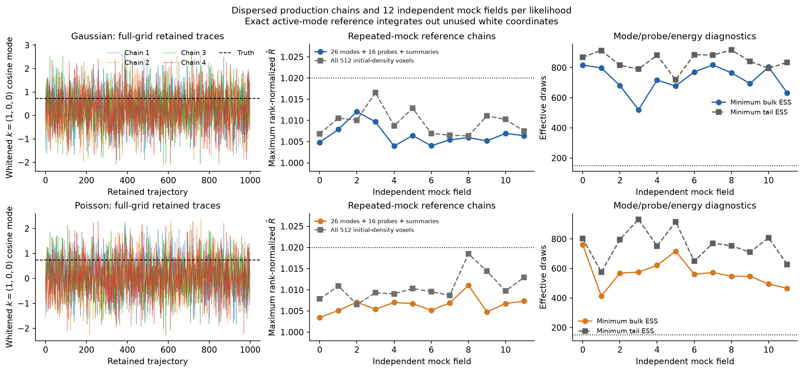
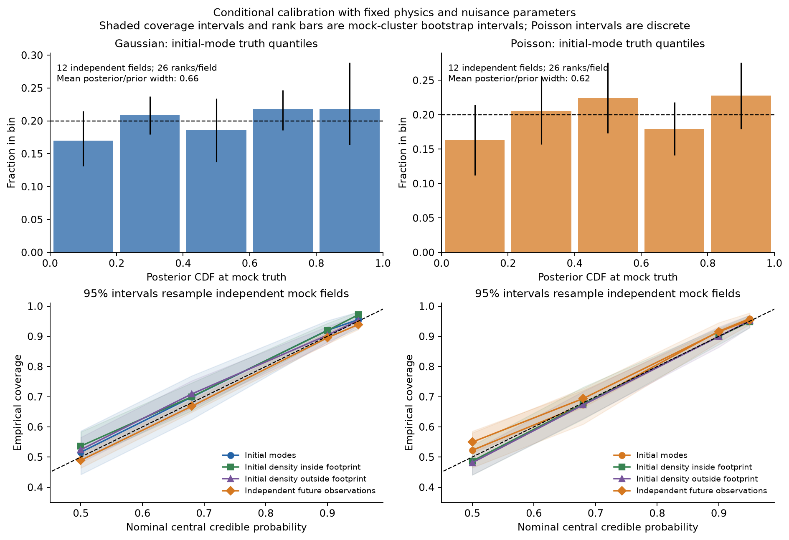
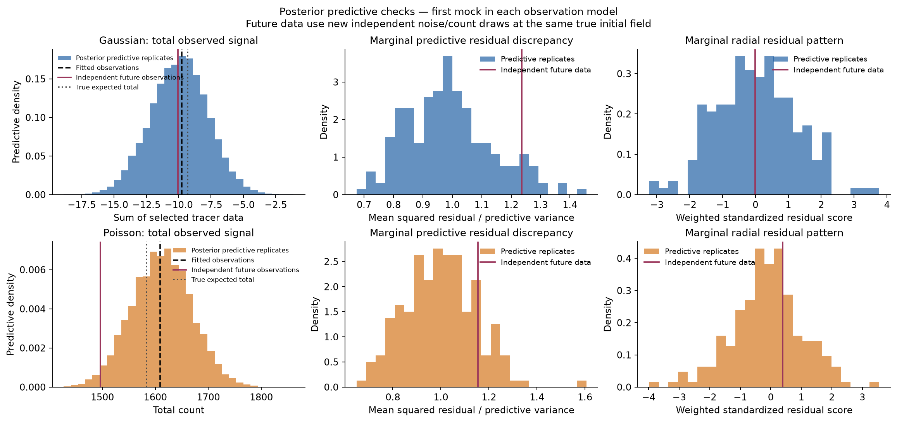
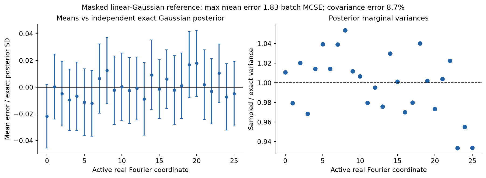
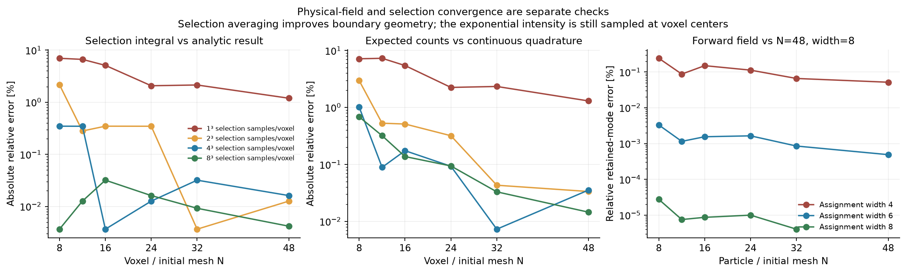

# Survey scientific validation results — 13 November 2026

## What was measured

This is bounded **conditional same-model calibration**, with fixed spectrum,
growth, biases, noise and exposure, 26 active real initial coordinates, 8^3
observation nodes, EdS 2LPT and plane-parallel RSD. It is not a production survey
or cosmological/nuisance inference validation. See [README.md](README.md) for the
complete probability laws, seeds, schedules and reproduction commands.

Twelve independent initial fields per Gaussian/Poisson family were sampled with
the exact active-mode reference (two dispersed chains each), with no excluded
mocks. Full-grid production sampling checks mocks 0–2 per family: four chains on
mock 0 and two on the others. Two-rank MPI reference sampling checks mock 0 of
both families. Both full-grid and active representations also have four-chain
masked linear-Gaussian references. The active reference integrates independent
unused white coordinates out exactly; its small dense metric is not a scalable
production algorithm. No production sampler or forward-model equations changed.

## Mixing and recovery

Reference-ensemble diagnostics after 400 warmup trajectories:

| Likelihood | Max mode/probe/energy Rhat | Max all-512-voxel Rhat | Min bulk ESS | Min tail ESS | Min acceptance |
|---|---:|---:|---:|---:|---:|
| Gaussian | 1.01207 | 1.01658 | 520 | 719 | 0.904 |
| Poisson | 1.01106 | 1.01850 | 413 | 575 | 0.898 |

All retained runs have zero divergences. All complete cases, including production,
MPI and linear references, passed the native thresholds. Python independently
checks native Rhat and requires all 512 physical-field Rhats below 1.02. The
native ESS checks cover modes, 16 probes, white power and potential, not every
linear combination. Finite-chain diagnostics do not prove convergence.

Most reference runs retained 800 draws/chain; Poisson mock 3 was rerun with 1600
because its all-voxel Rhat was 1.02553 at 800. It is now 1.00931. The original
short run remains in the raw review artifacts. Full-grid mock 0 retains 1000
samples/chain and full-grid mocks 1–2 retain 800.

Mean marginal initial-mode posterior widths, relative to their unit prior, are
0.658 (Gaussian) and 0.622 (Poisson).
Mean whole-box initial-field RMSE, divided by each truth field's error from a zero
prior-mean reconstruction, is 0.627 and 0.611.
These are averages of mock-level ratios; they are not an unbiased cosmological
transfer estimate. The same field is used for both observation families in each
mock pair.

## Coverage and posterior predictions

Numbers in brackets are 95% bootstrap intervals, resampling the 12 independent
mock fields 4000 times. Modes and voxels within a mock are correlated. These
intervals quantify a small ensemble's sampling variation; they are not precision
coverage certification. Poisson integer intervals can be conservative.

| Central interval and quantity | Gaussian coverage [bootstrap interval] | Poisson coverage [bootstrap interval] |
|---|---|---|
| 90% initial-mode intervals | 92.0% [88.1, 95.2] | 91.7% [88.1, 94.6] |
| 95% initial-mode intervals | 95.5% [92.6, 98.1] | 95.8% [93.9, 97.8] |
| 90% initial density inside footprint | 91.9% [89.4, 94.3] | 89.9% [87.3, 92.7] |
| 95% initial density inside footprint | 97.1% [96.0, 98.2] | 94.9% [92.8, 96.9] |
| 90% independent future voxels | 89.5% [87.5, 91.3] | 91.5% [90.4, 92.4] |
| 95% independent future voxels | 93.9% [92.2, 95.5] | 95.4% [94.3, 96.3] |

Initial-mode intervals are close to nominal in this conditional ensemble.
Gaussian inside-footprint initial-density 95% intervals cover 97.1%
(bootstrap interval 96.0–98.2%), which is conservative in this particular small
ensemble. That departure remains a validation finding; it is not removed by
rescaling posterior errors. A larger independent-mock ensemble is needed before
claiming full field-coverage calibration. Interpret future-observation coverage
with the finite-mock intervals above. Inspect all levels, rank bars and individual cases in [summary.json](summary.json),
rather than treating the nominal probabilities as exact measured performance.
Future voxel/total interval estimates use 128 independent conditional noise/count
draws per saved posterior state, with 32/64/128-draw refinement checks. The first
one-replica/state analysis had measurable Gaussian predictive-tail Monte Carlo
error; it is archived separately. Additional conditional draws improve noise
integration and do not increase posterior ESS. Residual-discrepancy histograms
keep one replica per state. Increasing 64 to 128 conditional draws changes mean
voxel coverage across the four levels by at most 0.33 percentage points
(Gaussian) and 0.083 percentage points (Poisson).
The predictive figure shows the first mock chosen by ID, including any tail
realization; it was not selected for a favorable predictive score. Independent
future observations use a new noise/count draw at the same true initial field.
Marginal discrepancies include posterior field uncertainty. Fitted-data PPC
p-values are descriptive, not uniform calibration statistics.

## Independent posterior and MPI checks

The largest active-coordinate mean error against an independently constructed
masked exact linear-Gaussian posterior is
0.0217 exact posterior SD, or
1.83 batch-mean Monte Carlo SE.
The full-grid representation gives
0.0459 SD and
2.70 MCSE.
Relative covariance Frobenius errors are
8.7% and
7.0%, respectively;
finite samples leave noticeable covariance error even when means agree well.

Across the six nonlinear full-grid/reference comparisons, the largest coordinate
mean difference is 2.77 pooled ESS-based MCSE. The two MPI/serial
reference comparisons give a maximum 0.00 MCSE. These are diagnostic
comparisons, with a conservative 5-MCSE failure bound, not formal independent
multiple-comparison tests. Shared seeds can correlate the runs; different
compiler/FFTW builds, metrics and rank layouts need not reproduce trajectories.
Covariance differences are retained in the JSON, without a precision covariance
convergence claim.

## Physical-field and selection convergence

The manufactured-field scan keeps the physical modes/cutoffs fixed and varies
N=8,12,16,24,32,48 with assignment widths 4,6,8. The retained-mode relative RMS
error at N=8,width=6 versus N=48,width=8 is 3.30e-5. This is a smooth low-bandwidth
field example, not a nonlinear cosmological resolution guarantee.

For the sharp spherical-cap footprint, N=8 point sampling underestimates the
selection integral by 6.97% and expected counts by 7.15%. Averaging selection over
8^3 sub-voxel samples reduces these absolute errors to 0.00366% and 0.685%.
At N=48 the corresponding errors are 0.00418% and 0.0146%. The remaining count
error includes voxel-center sampling of the nonconstant exponential intensity;
selection averaging alone does not implement a volume-integrated likelihood.
Convergence is not monotonic around a sharp boundary.

References are an analytic volume/selection integral and independent cylindrical
Gauss-Legendre quadrature for continuous expected counts. Doubling quadrature
resolution changes the reference count by
2.4e-15 relatively. This checks total
integrals, not the error of every individual voxel.

## Failure found and engineering checks

Gaussian mock 4 initially aborted during warmup because a nonfinite prediction
raised `invalid_argument`. `CartesianSurveyObservation::synthesize` now separates
layout errors from numerical overflow: nonfinite modes raise collective
`UnrepresentableState`, which the existing posterior maps to infinite potential.
HMC rejects the proposal and adapts normally. Layout and finite non-Hermitian
errors still propagate. The failed run is archived; mocks 4–11 were rerun with the
fix, and none were omitted. This does not change the finite-target probability law
or checkpoint identity schema.

Validation after that fix:

- Survey likelihood/nonlinear integration regression: 57 checks/rank on 1/2/4 MPI
  ranks (57/114/228 total), including one-owner nonfinite rejection and strict
  dimension errors.
- The same 57-check regression passes address and undefined-behavior sanitizers.
- Exact active-subspace/gradient/metric checks: 16/rank on 1/2/4 ranks; serial
  Clang and GCC checks also pass.
- Both new Make targets build successfully; the full-grid binary's 16 reference
  checks pass. Python analysis and plot rendering complete successfully.

The original eleven-mock **full-grid** follow-up launch was intentionally bounded
after mocks 1–2, at the next case boundary, to keep cost manageable. Its process
exit was therefore nonzero; the completed native cases are individually PASS.
The unfinished reference mock and superseded short-chain pilot runs are not
counted as successful experiments. All 24 final reference mocks are included.

## Remaining scope

Keep #52 open. Next work includes volume-integrated/validated observation
pixelization, mean-density/integral-constraint and likelihood nuisances, joint
parameter calibration, larger/more mock ensembles, tracer/model mismatch,
cosmology-dependent dynamics, and a PM/COLA adjoint if required. This experiment
establishes a reproducible small conditional test and exposes the boundary
modeling limitation; it does not remove those production requirements.
