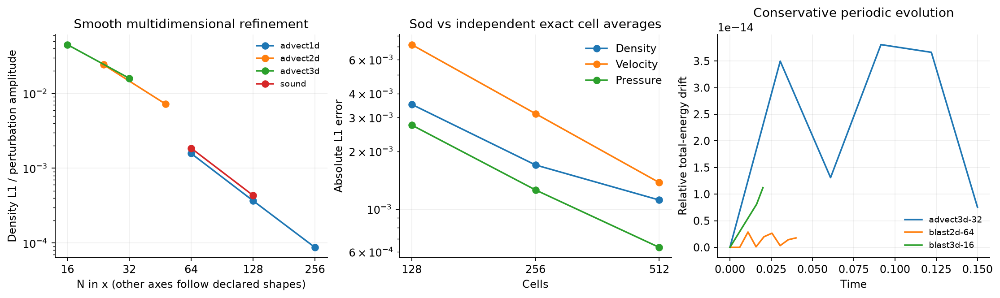
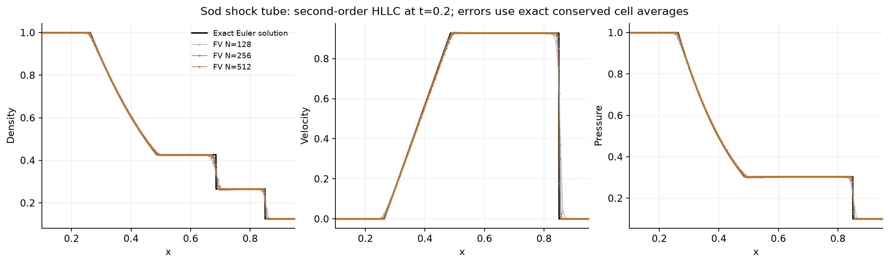
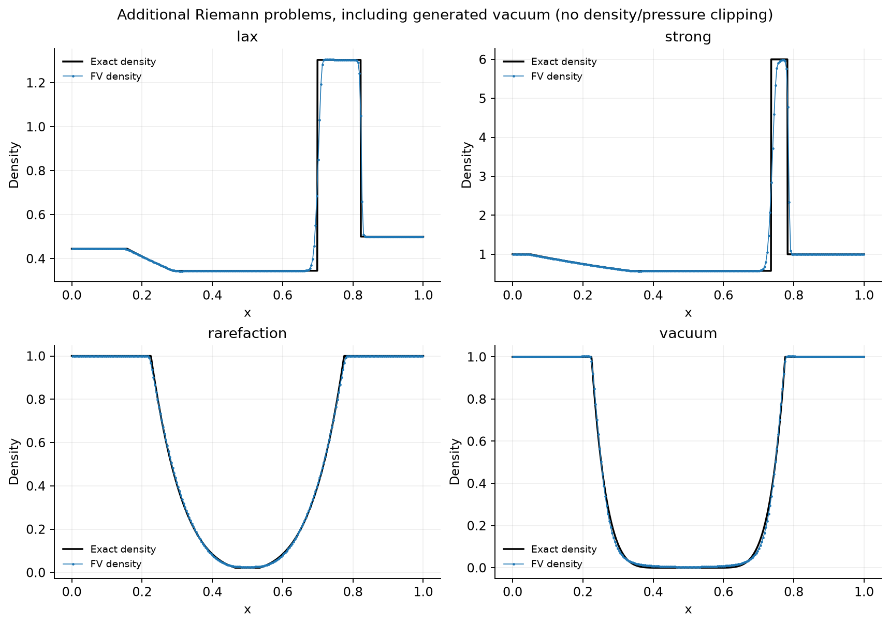
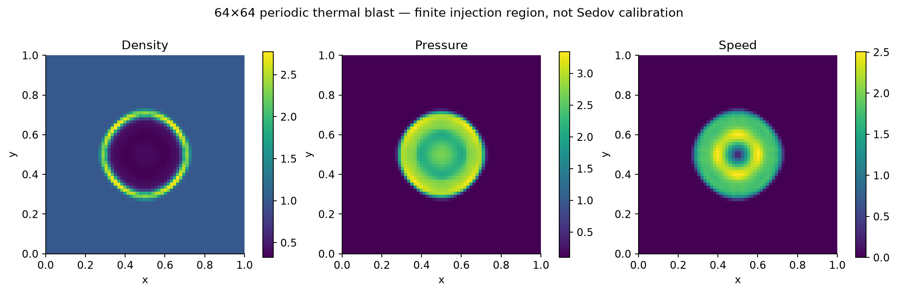

# Initial finite-volume validation — 13 November 2026

These are bounded verification experiments for backlog #51, not production
cosmological-gas or performance calibration. The [API guide](../README.md)
specifies units, fallback behavior, MPI layout and coupling limits.
Numerical measurements are preserved in [summary.json](summary.json).
The example and Python driver reproduce the raw runs and standalone PNG/PDF plots.

## Native regression and portability

Clang 17 serial, GCC 14 serial and Clang AddressSanitizer/UndefinedBehaviorSanitizer
runs pass **64 checks**. Open MPI/Clang 17 with OpenMP (2 threads) passes 64 checks
on 1 rank and **65 checks** on 2 and 4 ranks. The extra distributed check requires
multiple ranks. Tests cover all flux methods and normal axes, physical conversions,
normal/tangential contacts, exact Sod/star states, reflected exact solutions,
rarefaction/vacuum guards, 512 deterministic positive state pairs, mixed 3D boundary
corners, repeated one-cell reflections, one-cell slabs and empty ranks, conservative
updates, source errors, rollback/retries, and homogeneous comoving drag/cooling.
The latter's error falls from 4.13436e-7 to 1.03049e-7 when halving dt.

The same MPI tests and example also build/run using committed FML dependencies
from `3b6dd0da55da583280b1000bee1ed9ca17d66119`, independently of concurrent
Global/particle-domain work. Their 2-rank advection snapshot matches the working-tree
serial snapshot exactly. The existing shared `EquationOfState.h` is unchanged.
A previously built SPH regression executable was rerun successfully; it was not
rebuilt as part of this task.

## Smooth refinement

Default HLLC, limited primitive reconstruction, SSPRK2; gamma=1.4. Errors are density
L1 divided by perturbation amplitude. Multidimensional advection uses rectangular
meshes (Nx, Nx/2) or (Nx, Nx/2, Nx/2); these are modest resolutions, with componentwise
limiting and local loss of order near extrema.

| Test | Nx | L1 / amplitude | Observed order |
| --- | --- | --- | --- |
| 1D advection | 64 / 128 / 256 | 1.57684e-3 / 3.67963e-4 / 8.73326e-5 | 2.099 / 2.075 |
| 2D advection | 24 / 48 | 2.42321e-2 / 7.23549e-3 | 1.744 |
| 3D advection | 16 / 32 | 4.50425e-2 / 1.59706e-2 | 1.496 |
| Linear sound, amplitude 1e-4 | 64 / 128 | 1.85355e-3 / 4.33175e-4 | 2.097 |

The tested multidimensional rates are below two; no general observed second-order
claim is made. Sound uses the small-amplitude analytic wave, not a finite-amplitude
nonlinear exact solution.

## Shock tubes and vacuum

Python analysis independently solves pressure matching by linear-pressure bisection
(the C++ exact reference uses log pressure). Exact conserved profiles are integrated
with wavefront-split eight-point Gauss quadrature before conversion to cell-average
primitive quantities. Errors are absolute L1 density/velocity/pressure.

| Problem | Cells | Density | Velocity | Pressure |
| --- | --- | --- | --- | --- |
| Sod | 128 | 3.51060e-3 | 7.18510e-3 | 2.73884e-3 |
| Sod | 256 | 1.69761e-3 | 3.14028e-3 | 1.25837e-3 |
| Sod | 512 | 1.11497e-3 | 1.37469e-3 | 6.31926e-4 |
| Lax | 256 | 7.63234e-3 | 4.25121e-3 | 5.11524e-3 |
| Strong shock | 256 | 5.74101e-2 | 1.20736e-1 | 2.64811 |
| Two rarefactions | 256 | 3.02372e-3 | 1.09698e-2 | 1.55074e-3 |
| Generated vacuum | 256 | 6.41883e-3 | 5.90285e-2 | 6.34961e-3 |

Sod errors decrease in every field across the tested resolutions. All evolved cells
remain positive without density/pressure floors. Rarefaction and vacuum runs invoke
8 and 11 guarded HLLC-to-HLLE fallbacks respectively. The numerical vacuum is a
positive finite-resolution approximation (minimum rho=0.00395407, P=0.00206588),
while the exact reference has rho=P=0. Vacuum velocity errors exclude the exact
vacuum interval, where velocity has no unique physical meaning.

## Conservation, MPI replay and dual energy

All default periodic scientific runs have zero dual-energy repairs. Maximum final
relative mass drift is 5.33e-15 and maximum final relative total-energy drift is
1.12e-14. Saved intermediate histories can have larger roundoff excursions (shown
above). The five tested MPI final cell tables match their serial counterparts
exactly: 1/2/4-rank 2D advection, 2-rank Sod and 2-rank 3D blast. This is a result for
these fixtures, not a universal bitwise-reproducibility or scaling guarantee.

The scientific fixtures require no global first-order stage fallback or timestep
retry; separate cold-gravity regression tests exercise failed-step rollback,
Rusanov-stage fallback and adaptive retries. Tests also verify collectively rejected
one-rank invalid initial/replacement states and bad gravity outputs.

Optional dual energy is explicitly nonconservative when E is repaired from the
auxiliary thermal energy. In the serial high-Mach advection fixture (bulk speed
1e8), maximum pressure error is 7.77e-16, signed energy repair is +1.46875 and
accumulated absolute repair is 26.25 in fixture units. These repairs are tiny
relative to bulk kinetic energy but substantial relative to thermal energy; they
must not be described as exact energy conservation. Initialization/replacement
repairs have separate ledgers. A high-Mach stationary tangential contact additionally
checks that HLLE transports the auxiliary density conservatively without spurious
thermal diffusion when that density is constant across the face.

## Multidimensional blasts and remaining scope

2D (64x64) and 3D (16 cubed) periodic finite-radius overpressure blasts retain
positive gas and conserve mass/total energy to roundoff. These are finite-pressure,
finite-radius examples; no Sedov similarity accuracy or blast refinement claim is
made. The 2D fields below show the Cartesian morphology.

Open work includes native SimulationCode gas/Poisson/species coupling, hydrostatic
and self-gravitating/cosmological collapse calibration, broader high-Mach shock and
shear tests, Sedov calibration, general EOS, checkpoints and performance/scaling
measurements. Prescribed homogeneous expansion and external gravity hooks have
bounded regression coverage, not a validated coupled self-gravity energy budget.
