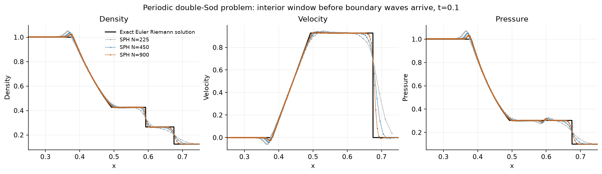
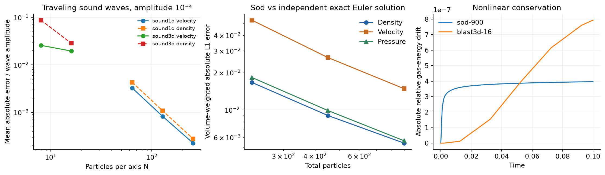
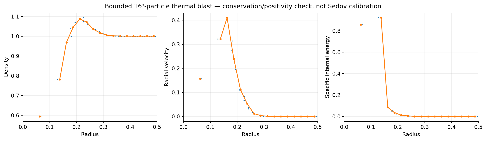

# Initial SPH validation — 13 November 2026

## Scope

This is a bounded verification of the new periodic density-energy SPH module,
with a constant-gamma ideal gas, adaptive smoothing lengths/grad-h, artificial
viscosity with optional Balsara limiting, optional artificial conductivity and
shared-step Heun RK2. The equations are documented in [../README.md](../README.md).
It does not complete backlog #50 or establish production cosmological accuracy.

The core requires Global/C++17 only, with optional slab MPI/OpenMP. All new source
is independent of concurrent particle-domain edits: an isolated copy of committed
Global/Timing/MemoryLogging/Performance headers and Global.cpp at `26a5e9b` was
built with the new SPH headers and tested separately. No changes to shared
transport or existing particle/gravity algorithms are required by this addition.

## Numerical and engineering checks

- 51 collective checks pass in serial and one-rank MPI; 53 pass at two/four ranks
  (the extra checks exercise deliberately rank-inconsistent inputs).
- Clang 17 and GCC 14 serial tests pass. The full 51-check serial suite also
  passes address and undefined-behavior sanitizers.
- MPI/OpenMP tests use two threads, 1/2/4 ranks, including valid spatially empty
  ranks, globally empty gas, nonadjacent support ghosts and 512-byte forced
  chunking. The same MPI tests pass against the isolated committed baseline.
- Both example Make configurations build, and the new tests' Make target builds
  and runs against that isolated baseline.

Kernel normalization and radial/h derivatives have independent quadrature and
finite-difference checks in 1D/2D/3D. Density/grad-h roots and full force/heat sums
compare with explicit all-pair references using unequal masses, irregular
positions and support-union pairs. Across the recorded serial fixtures:

- Maximum density/Omega error versus all-pair sums: 8.89e-16.
- Maximum relative adaptive-root residual: 1.28e-12 (requested tolerance 2e-12).
- Maximum force discrepancy: 7.33e-15; heat discrepancy: 5.56e-16.
- Absolute total momentum-rate residual is below 9.37e-17; total gas-energy-rate
  residual is below 2.09e-17, in the fixtures' code units.
- The independent fixed-entropy internal-energy directional derivative agrees
  with pressure forces to at most 1.84e-10 absolutely. This is a variational
  check on the adaptive equations, beyond comparing two force traversals.

Additional checks cover viscosity heating/kinetic dissipation, conductivity energy
conservation and entropy sign, the shear/compression switch, exact uniform-flow
advection/migration, global unique IDs (including remote duplicates), one-owner
bad inputs/force callbacks, root exhaustion, and predictor-failure rollback of
positions, velocities, energy, smoothing guesses and epoch. Mass rescaling by
1e160 preserves hydrodynamic rates without forming an overflowing rho-squared
pressure denominator.

Nonuniform comoving pressure terms scale as 1/a, with explicit Hubble drag and
adiabatic cooling. A regression ensures Hubble separation suppresses artificial
viscosity when peculiar velocities converge but physical pairs still recede.
Uniform expansion with a=exp(0.2t), gamma=5/3 reproduces v~a^-1 and u~a^-2:
errors at dt=0.02 and 0.01 are 4.1240e-7 and 1.0279e-7, a factor 4.01.
These are prescribed-background checks, not a self-gravitating cosmological gas
simulation. External acceleration is checked for single application and output
shape/finite-value rejection.

## Sound waves

A traveling wave of amplitude 1e-4 is initialized by a Lagrangian position
perturbation with isentropic temperature and matching velocity. Density errors
use the independently evaluated uniform-lattice SPH density as their background;
this removes a constant kernel-sampling offset, rather than subtracting wave
errors. Reference fields are evaluated at the evolved positions.

| Dimension and N per axis | Velocity L1 / amplitude | Density L1 / amplitude |
|---|---:|---:|
| 1D, 64 | 0.00325145 | 0.0042849 |
| 1D, 128 | 0.000822902 | 0.00107875 |
| 1D, 256 | 0.000224888 | 0.000277775 |
| 3D, 8 | 0.0256872 | 0.0870482 |
| 3D, 16 | 0.0194975 | 0.0283787 |

1D errors fall approximately quadratically on this sequence. **The 3D velocity
error improves much more weakly**, from 2.57% to 1.95% of the wave amplitude.
No general 3D second-order or continuum-convergence claim is made. Fixed eta=1.2,
kernel sampling, particle disorder and neighbor-number convergence need a broader
study; alternative kernels are a sensible follow-up. Sound-wave relative total
energy changes remain below 5e-14 in these small-amplitude runs.

The 8^3 case is evolved with serial execution and 1/2/4 MPI ranks using OpenMP
replay builds. Maximum absolute differences of the ID-ordered particle/field
tables are {'1': 0.0, '2': 0.0, '4': 0.0}. The isolated baseline's two-rank replay differs by
0. These are observations for this fixture/build, not cross-hardware
bitwise guarantees or performance/scaling measurements.

## Sod shock tube

A periodic double-Sod setup uses equal particle masses with eight times as many
particles per unit length on the high-density side, gamma=1.4, eta=1.5,
viscosity (alpha,beta)=(1,2), no shear limiter and conductivity alpha_u=0.2.
The interior x=(0.25,0.75) window at t=0.1 is compared before boundary waves arrive.
The independent Python reference solves the Euler pressure matching equation and
samples its left rarefaction, contact and right shock; it does not call any SPH
kernel or production Riemann solver.

Errors are particle-volume-weighted with m/rho in that window, in code units:

| Particles | Density L1 | Velocity L1 | Pressure L1 | Relative gas-energy drift |
|---|---:|---:|---:|---:|
| 225 | 0.0166487 | 0.0529734 | 0.0182545 | 1.5e-06 |
| 450 | 0.00899766 | 0.0264208 | 0.00987115 | 7.72e-07 |
| 900 | 0.00538928 | 0.0148241 | 0.00563098 | 3.96e-07 |

All three errors decrease with resolution. Residual contact/rarefaction features
remain visible. The solution is a verification example, not evidence for robust
multidimensional turbulent mixing or a complete hydrodynamics benchmark suite.

## Three-dimensional thermal blast

A 16^3 lattice starts with u=1e-5, with thermal energy 0.01 distributed over an
injection sphere of radius 0.12. The periodic box has unit size and total mass 1.
The run evolves to t=0.1 with maximum dt=0.002, viscosity and conductivity alpha_u=0.1.
It remains positive and expands radially. Relative gas-energy drift is
7.94e-07, total momentum norm is
1.06e-18, and minimum final u is
1e-05. The finite injection region/coarse mesh is **not**
a calibrated point-explosion Sedov self-similar test. Radial scatter and mean
profiles are shown to expose, rather than conceal, that limited resolution.

## Reproduce and remaining work

Build serial/MPI copies of [../example/Main.cpp](../example/Main.cpp), then run
[run_validation.py](run_validation.py) with their paths and a fresh output folder,
as described in the module README. Its commands, statuses, timings and SHA256
records accompany raw slab snapshots/history and PNG/PDF plots. NumPy/Matplotlib
are required; SciPy is not. [summary.json](summary.json) retains portable results.
The normal module-test discovery includes the fast C++ regression; the fluid
experiments are an explicit separate invocation.

The root workspace review bundle retains exact commands, full logs, raw final
outputs, executable/source hashes and an isolated committed dependency snapshot.
Initial runs were used to develop stronger fixtures, including alternating 1D
masses that genuinely cross unequal smoothing supports. Final results use the
finished equations. No controlled runtime or distributed scaling claim is made.

Open scope includes native SimulationCode gas/collisionless/gravity integration,
full cosmological shock/collapse and Sedov calibration, contact/Kelvin–Helmholtz
and hydrostatic tests, alternative-kernel/neighbor convergence, checkpoint/restart,
nonperiodic boundaries, general EOS, individual timesteps and large-volume MPI
performance. Item 51's production Riemann/finite-volume solvers remain separate;
only a common ideal-gas primitive and a validation-only exact Sod reference were
added here. This initial SPH implementation remains uncommitted for user review.
