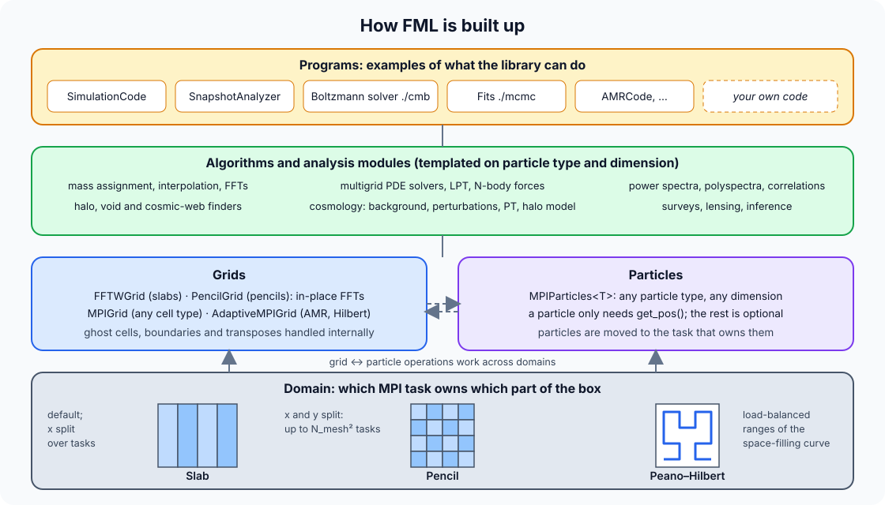

# FML

[](https://github.com/HAWinther/FML/actions/workflows/ci.yml?query=branch%3Amaster) [](https://github.com/HAWinther/FML/actions/workflows/nightly.yml) [](https://github.com/HAWinther/FML/issues) [](http://hits.dwyl.com/HAWinther/FML)

**This is FML 2.0.** The library is constantly under construction. The changes since 1.0 are in the [changelog](FML/CHANGELOG.md); for the old version see [Version 1.0](#version-10). Development happens in the FMLDevelop branch.

**FML is a C++17 library for large-scale-structure cosmology.** It started as a set of general building blocks for
working in parallel: grids that do FFTs, particle containers, mass assignment and PDE solvers, where the library takes
care of the MPI and OpenMP parallelisation so that you can write an algorithm without thinking about how the data is
split over tasks. On top of these it has grown to cover almost everything one needs in large-scale structure: the
expansion history and the linear Einstein–Boltzmann equations, initial conditions and simulations, halo and void
finding, clustering statistics, survey estimators and parameter inference. And not only for ΛCDM, but for any
cosmological model you add.

## The ideas behind FML

<p align="center"></p>

- **Parallel without having to think about it.** The data structures know how they are distributed. A grid knows which
  part of the box it owns, exchanges its ghost cells and does distributed FFTs; a particle container sends particles
  to the task that owns them. Algorithms are written on top of these and run the same way in serial, with MPI, with
  OpenMP or with both. The one thing to keep in mind is that collective functions are called by all tasks.
- **Built up in layers: domain → grids and particles → algorithms → programs.** A *domain* says which MPI task owns
  which part of the box: slabs (the default), pencils (x and y split, for up to N_mesh² tasks) or load-balanced ranges
  of a Peano–Hilbert curve. Grids (`FFTWGrid` on slabs, `PencilGrid` on pencils, the general `MPIGrid` and the
  adaptively refined `AdaptiveMPIGrid`) and particles (`MPIParticles`) live on a domain. The particles can be on the
  same domain as a grid or on another one, and the operations between them (mass assignment, interpolation) work
  across domains. The algorithms are written against a common grid interface, so most of the library, SimulationCode
  and SnapshotAnalyzer run on slabs or on pencils.
- **General through templates.** Classes and algorithms are templated on the particle type and on the number of
  dimensions. Your own particle struct works as it is: it needs `get_pos()`, and the library detects at compile time
  which other members (velocity, mass, ID, ...) it has and uses them if it needs them. Most of the library is
  header-only.
- **Easy to extend.** A module is a folder with its headers, a README, an example and tests. A new analysis method
  uses the grids and particles and gets the parallelisation from them.
- **Lightweight.** You need a C++17 compiler and make. FFTW (Fourier transforms) and GSL (splines, ODEs) are used by
  most of the library; MPI, OpenMP, Lua, HDF5, CGAL and Python are optional and only needed by the modules that use
  them. There are no large dependencies such as Boost: the multigrid solvers, halo finders, KD-tree, FFTLog, samplers,
  the Boltzmann solver and so on are all part of the library.
- **Any cosmological model.** The physics is implemented once and shared: the same background and the same
  quasi-static gravity (μ and Σ) drive the Einstein–Boltzmann solver, the growth factors, LPT, the halo model and the
  simulations. A new model (dark energy, modified gravity, interacting dark sectors, ...) is a header and an entry in
  a registry for the Einstein–Boltzmann solver and everything built on its background, and the gravity models of
  SimulationCode use the same quasi-static definitions. Some twenty models are included.
- **Programs as examples.** SimulationCode (formerly COLASolver), SnapshotAnalyzer, the Einstein–Boltzmann solver,
  CosmologyFitting and AMRCode were written to show what can be done with the library. They have grown into codes that
  are useful in their own right, and they are also the most demanding tests of the building blocks.
- **Tested and validated.** About 200 test programs compare with analytic results, manufactured solutions,
  conservation laws and external codes (CLASS, CAMB, CCL, FAST-PT, MG-PICOLA, ...). They run in CI on every push with
  1 and 4 MPI tasks, and with longer accuracy checks every night. The module READMEs say what has been validated and
  over which range.

## What's inside

**Parallel building blocks**
- Grids for FFTs (`FFTWGrid`, real and complex) split in slabs, or in [pencils](FML/PencilDomain/README.md) for
  many tasks, behind one grid interface; a general distributed grid (`MPIGrid`); and an
  [adaptively refined grid](FML/AdaptiveMPIGrid/README.md) distributed along a Peano–Hilbert curve.
- `MPIParticles`: a container for any particle type that sends particles to the task that owns them, with slab,
  pencil or Peano–Hilbert domains.
- Particle–grid assignment and interpolation (B-splines from NGP to PQS, interlacing, window deconvolution), also for particles on
  any domain, and non-uniform FFTs.
- [Multigrid solvers](FML/MultigridSolver) for general (non-linear) PDEs, on uniform and on adaptive grids.
- Smoothing and convolutions, random fields, splines and ODE solvers (GSL wrappers), FFTLog, a KD-tree, Lua parameter
  files, and reading and writing Gadget (binary and HDF5), RAMSES and ascii files.

**Simulations**
- [SimulationCode](FML/SimulationCode/README.md): a complete PM/COLA N-body code driven by a parameter file. Many
  cosmologies and theories of gravity (f(R), DGP, symmetron, dilaton, Jordan–Brans–Dicke, cubic Galileon, reduced
  Horndeski, coupled and interacting dark energy, dark scattering, μ–Σ), screening solved exactly with multigrid or
  approximated, massive neutrinos, separate CDM and baryons, lightcones, and power spectra, bispectra, halos and
  more computed on the fly.
- The pieces to build your own: Gaussian and non-Gaussian initial conditions (N-GenIC compatible), 1LPT–3LPT and
  arbitrary-order LPT, PM forces and time stepping (COLA, FastPM, BullFrog), short-range forces for P3M/TreePM, and
  modified-gravity solvers.
- Smaller, newer codes: an [AMR N-body code](FML/AMRCode/README.md), [wave dark matter](FML/WaveDarkMatter/README.md)
  (Schrödinger–Poisson), and gas dynamics with [finite volumes](FML/Hydrodynamics/README.md) and
  [SPH](FML/SPH/README.md).

**Analysing simulations and surveys**
- Power spectra, multipoles, bispectra and higher polyspectra; pair counting and 2- and 3-point correlation
  functions.
- Surveys: power-spectrum multipoles with window functions, and BAO reconstruction.
- Halos and structures: friends-of-friends (also relaxed FoF), spherical-overdensity masses, a phase-space halo and
  subhalo finder, merger histories, void finders (ZOBOV, voxel watershed, spherical), Delaunay tessellations and the
  DTFE, and cosmic-web classification.
- Summary statistics: counts-in-cells, kNN distributions, density-split and marked statistics, Minkowski functionals,
  weak-lensing maps, and HOD mocks and baryonification.
- [SnapshotAnalyzer](FML/SnapshotAnalyzer/README.md): all of this on Gadget snapshots from a parameter file.

**Theory**
- An [Einstein–Boltzmann solver](FML/Cosmology/EinsteinBoltzmannSolver/README.md) (background, recombination,
  perturbations, CMB and matter spectra, lensing) for ΛCDM and many extensions, validated against CLASS.
- Perturbation theory: one-loop SPT, Lagrangian and IR-resummed Eulerian PT for biased tracers in redshift space,
  TNS and EFTofLSS, and hybrid-bias spectra.
- Nonlinear power spectra: Halofit, HMcode-2016/2020, a general halo model, ReACT, EuclidEmulator2, and spherical
  collapse with screening.

**Inference**
- MCMC (adaptive Metropolis–Hastings) and HMC samplers, cosmological fits with supernova, BAO, BBN and CMB
  likelihoods, and trainable neural-network emulators.
- [Field-level inference](FML/FieldLevel/README.md) with linear, LPT and particle-mesh forward models and their
  adjoints, on slabs or pencils.

The [capability matrix](FML/CAPABILITIES.md) lists every module with its scope, dependencies, parallel behaviour and
tests, and the [website](https://fml.wintherscoming.no/) explains the methods.

## Example

The power spectrum of a particle catalogue. Positions are in [0, 1), and every MPI task keeps the particles in its
slab:

```cpp
#include <FML/ComputePowerSpectra/ComputePowerSpectrum.h>
#include <FML/MPIParticles/MPIParticles.h>
#include <FML/RandomGenerator/RandomGenerator.h>
#include <iostream>

// Any particle type with get_pos() works: no base class needed
struct Particle {
    double x[3];
    double * get_pos() { return x; }
    constexpr int get_ndim() const { return 3; }
};

int main() {
    // A uniform random catalogue in the unit box
    std::vector<Particle> catalogue(100000);
    FML::RANDOM::RandomGenerator rng;
    for (auto & p : catalogue)
        for (auto & x : p.x)
            x = rng.generate_uniform();

    // Distribute the particles over the MPI tasks
    FML::PARTICLE::MPIParticles<Particle> part;
    part.create(catalogue.data(), catalogue.size(), 2 * catalogue.size() / FML::NTasks, FML::xmin_domain,
                FML::xmax_domain, true);

    // P(k) on a 128^3 grid with cloud-in-cell assignment and interlacing
    FML::CORRELATIONFUNCTIONS::PowerSpectrumBinning<3> pofk(64);
    FML::CORRELATIONFUNCTIONS::compute_power_spectrum<3>(
        128, part.get_particles_ptr(), part.get_npart(), part.get_npart_total(), pofk, "CIC", true);
    pofk.scale(1000.0); // a box of 1000 Mpc/h: k in h/Mpc, P in (Mpc/h)^3

    if (FML::ThisTask == 0)
        for (int i = 0; i < pofk.n; i++)
            std::cout << pofk.kbin[i] << " " << pofk.pofk[i] << "\n";
}
```

Compile it from the folder that contains `FML/`, linking `FML/Global/Global.cpp`:

```sh
c++ -std=c++17 -O3 -I. -DUSE_FFTW pofk.cpp FML/Global/Global.cpp -lfftw3 -o pofk
mpicxx -std=c++17 -O3 -I. -DUSE_MPI -DUSE_FFTW pofk.cpp FML/Global/Global.cpp -lfftw3_mpi -lfftw3 -o pofk  # with MPI
```

Each module folder has examples (`example/`) and a README with its conventions.

## Building

You need a C++17 compiler and make. FFTW is needed for anything with Fourier transforms. MPI, OpenMP, GSL, Lua, HDF5,
CGAL and Python are optional and only needed by the modules that use them. Set paths and compilers in
`FML/Makefile.local`; the defaults are in [Makefile.config](FML/Makefile.config).

```sh
git clone https://github.com/HAWinther/FML.git

make -C FML examples -j4                                  # build the examples
make -C FML test MPIRUN=mpirun NP_LIST="1 2 4"           # run the regression tests with 1, 2 and 4 MPI tasks
make -C FML/tests USE_MPI=false USE_OMP=false USE_FFTW=false USE_GSL=false USE_LUA=false test_core   # minimal serial test
```

The examples need no data files: they make their own input. The [build guide](FML/BUILDING.md) explains the options
and how to use FML from your own code. Clean the objects when you change the compiler, precision or feature flags.

### Version 1.0

The previous version, FML 1.0, is the tag `v1.0.0`. To get it (with the `TestData` submodule its examples use):

```sh
git clone --branch v1.0.0 --depth 1 --recursive https://github.com/HAWinther/FML.git FML-1.0
```

## Python

A small [Python package](FML/PythonAnalysis/README.md) has catalogue statistics: kNN distances and CDFs, and
counts-in-spheres PDFs and moments, with NumPy results.

```sh
python -m pip install ./FML/PythonAnalysis
python FML/PythonAnalysis/examples/catalogue_statistics.py
```

There is also a [SWIG wrapper tutorial](FML/MakePythonWrapper) and a pybind11 wrapper for the
[halo model](FML/HaloModel/PythonWrapper/README); build them with `make -C FML python`.

## Documentation

- [Capability matrix](FML/CAPABILITIES.md): every module, with its scope, dependencies, parallel behaviour and tests.
- [Build and API guide](FML/BUILDING.md): compiling, linking, MPI and FFTW conventions.
- [References](FML/REFERENCES.md): the papers and external codes behind each module.
- [SimulationCode](FML/SimulationCode/README.md): the N-body code, its [parameters](FML/SimulationCode/PARAMETERS.md)
  and [tests](FML/SimulationCode/tests/README.md).
- [Changelog](FML/CHANGELOG.md) and [development backlog](FML/DEVELOPMENT_BACKLOG.md).
- [Website](https://fml.wintherscoming.no/) and [Doxygen reference](https://fml.wintherscoming.no/doxygen/); their
  sources are in [Documentation](Documentation/), with the LaTeX source of the FML book.

The regression tests run in CI on every push. They compare against analytic results or reference codes where
possible. The module READMEs describe what has been validated and over which range, so check them before relying on
a method in a new regime.

## Contributors

FML is developed by Hans A. Winther. Many people have helped improve it, among them Bartolomeo Fiorini, Guilherme
Brando, Kazuya Koyama, Daniela Saadeh, Herman Sletmoen and Renate Mauland-Hus. The two main developers these days are Claude and Codex.

## Licence

Except for third-party code carrying separate license notices, FML's original source code is licensed under the GNU
General Public License as published by the Free Software Foundation, either version 3 of the License, or (at your
option) any later version (`GPL-3.0-or-later`). See [LICENCE](LICENCE) for the full license text.

FML is distributed in the hope that it will be useful, but WITHOUT ANY WARRANTY; without even the implied warranty of
MERCHANTABILITY or FITNESS FOR A PARTICULAR PURPOSE. See the GNU General Public License for more details.

Third-party code retains its existing copyright and license notices. In particular, `FML/Global/SystemMemory.h`
carries a CC BY 3.0 notice; this GPL statement does not relicense that file. Its compatibility or replacement must be
resolved before distributing a combined GPL-covered work that includes it. Other bundled third-party components and
external dependencies remain subject to their respective licenses. This statement covers source code and does not
change the licensing of separately published documentation.
